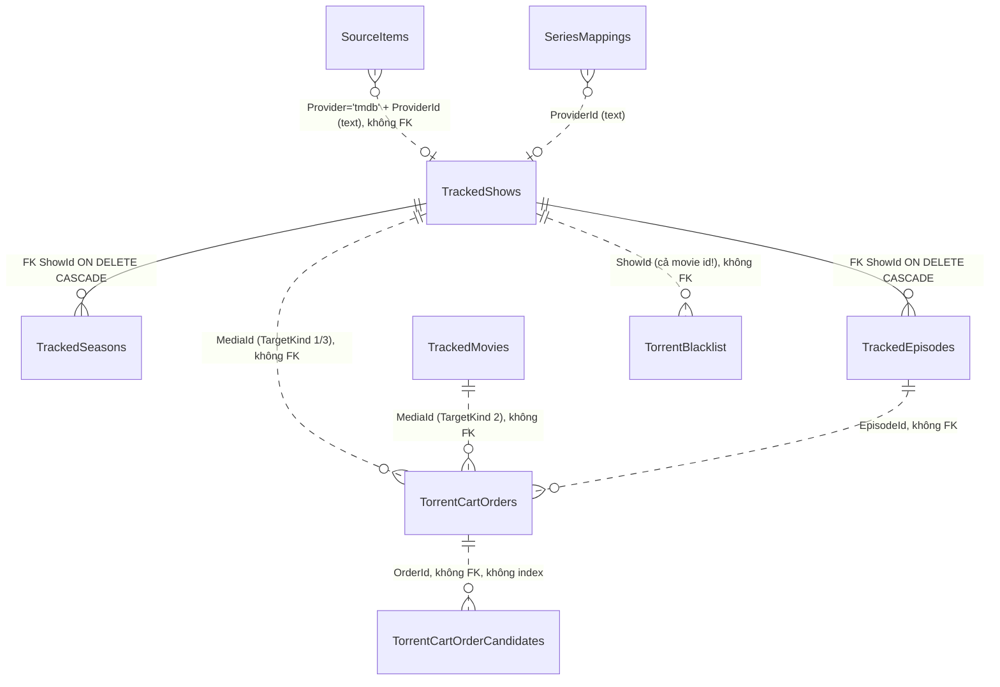

# Audit tầng database (2026-11)

Phạm vi: `Services/DatabaseService.cs` (3.306 dòng, 41 commit), `Services/IDatabaseService.cs` (29 commit),
`MediaManager.Core/Migrations/*`, các model lưu xuống DB, mọi chỗ mở `SqliteConnection` ngoài service,
tests `MediaManager.Core.Tests/Migrations`. Thang mức độ và chuẩn bằng chứng theo
[00-method-and-scope.md](../00-method-and-scope.md). Đây là audit chỉ đọc: không sửa code app, không ghi vào DB thật.

Baseline: nhánh `claude/database-audit-b34d45` tại `ff2caa3` (2026-11-12). Không đào sâu nghiệp vụ Auto-Track,
luồng xóa và parser (đã có phiên audit riêng); các finding chạm tới những vùng đó chỉ xét ở tầng DB.

## Tóm tắt

| ID | Mức | Tiêu đề | Trạng thái |
|----|-----|---------|-----------|
| DB-01 | High | DB tạo trước 2026-06-15 bị migration 007 chặn khởi động vĩnh viễn | Tái hiện trên bản chép DB thật |
| DB-02 | Medium | Restore ghi đè DB đang chạy, không giữ bản cũ, không kiểm tra trước khi ghi đè (mở rộng AUD-003) | Chứng minh tĩnh + kết hợp DB-01 |
| DB-03 | Medium | Lưu Settings gọi lại `Initialize` và đổi DB nóng khi đổi StateFolder | Tái hiện |
| DB-04 | Medium | Order đã xóa bị "sống lại" khi tác vụ nền lưu bản cũ (`ON CONFLICT(Id)`) | Tái hiện |
| DB-05 | Medium | Ghi đè cả dòng từ snapshot cũ làm mất cập nhật của tác vụ khác | Tái hiện |
| DB-06 | Medium | Đổi tổ chức tập xóa season/episode trước khi gọi TMDB, không transaction, mất rating/thought | Chứng minh tĩnh |
| DB-07 | Medium | FK bật trong transaction migration: migration rebuild bảng cha sau này sẽ xóa sạch bảng con | Tái hiện cơ chế (tiềm ẩn) |
| DB-08 | Medium | AUD-006 vẫn còn nguyên: blacklist fail-open | Xác nhận lại |
| DB-09 | Low | Bảng order, candidate, blacklist không có FK, blacklist dùng chung không gian ID show và movie | Tái hiện + số liệu DB thật |
| DB-10 | Low | Journal `delete`, không WAL, chờ khóa mặc định 30 s, reader chặn writer | Tái hiện, chưa thấy trong log |
| DB-11 | Low | Mỗi lệnh một connection và một autocommit, thiếu index cho order và candidate | Đo được |
| DB-12 | Low | Không chặn DB đến từ bản app mới hơn | Tái hiện |
| DB-13 | Low | `FilePath` UNIQUE phân biệt hoa thường trong khi app so sánh không phân biệt | Tái hiện |
| DB-14 | Low | Đọc ngày giờ blacklist: chuỗi rỗng làm ném lỗi, `Kind` sai | Tái hiện |
| DB-15 | Low | Schema trôi và nợ bảo trì (DDL kép, cột chết, reader theo vị trí, splitter SQL thô) | Chứng minh tĩnh |

Không có finding Critical. DB-01 gần ngưỡng Critical ("startup failure lặp lại"), nhưng chỉ xảy ra với DB tạo bởi
bản từ trước 2026-06-15, mà bản đó có lẽ không còn là cấu hình được hỗ trợ. Vì vậy xếp High.

## Kết quả kiểm chứng

| Hạng mục | Kết quả |
|----------|---------|
| `dotnet test MediaManager.Core.Tests` (Debug x64) | 248/248 pass (4 test migration) |
| `dotnet test MediaManager.App.Tests` (Debug x64) | 138/138 pass, không đụng tới `<StateFolder>` (đã so sánh mtime trước và sau khi chạy) |
| Bản chép DB thật (`media-manager.db`, 2,4 MB), mở `mode=ro` | `integrity_check=ok`, `foreign_key_check` rỗng, 8/8 migration, `journal_mode=delete`, `user_version=0` |
| Log app `<StateFolder>\logs` (29/10 → 12/11/2026, 99 file) | Không có `SqliteException`, `database is locked`, lỗi migration hay constraint. Cảnh báo duy nhất liên quan là backup lỗi DNS (không phải DB). |
| Harness tái hiện (scratchpad, ngoài repo) | 11 kịch bản S1–S11, kết quả trích dưới mỗi finding |

Harness là console C# tham chiếu trực tiếp `media management app.csproj`, chạy `DatabaseService` và
`MigrationRunner` thật trên DB tạm hoặc bản chép. Mã nguồn harness không commit vào repo. Các bản DB cũ dùng ở S1
được chép từ `<StateFolder>` (bản sao lưu thủ công ngày 12/06, 22/06 và 10/07/2026). Báo cáo không ghi
nội dung cá nhân trong DB, chỉ ghi schema và số liệu.

## Sơ đồ schema (DB thật, 12/11/2026)



| Bảng | Dòng | Cột | Khóa và ràng buộc | Index ngoài PK |
|------|-----:|----:|-------------------|----------------|
| SourceItems | 299 | 38 | `FilePath UNIQUE` (BINARY) | autoindex FilePath |
| SeriesMappings | 4 | 11 | `UNIQUE(NormalizedParsedTitle, ParserPattern)` | autoindex |
| TrackedShows | 35 | 42 | `TmdbId UNIQUE` | autoindex |
| TrackedSeasons | 108 | 23 | `UNIQUE(ShowId, SeasonNumber)`, FK cascade | autoindex |
| TrackedEpisodes | 2.318 | 28 | `UNIQUE(ShowId, SeasonNumber, EpisodeNumber)`, FK cascade | autoindex |
| TrackedMovies | 15 | 33 | `TmdbId UNIQUE` | autoindex |
| TorrentCartOrders | 112 | 31 | không | không |
| TorrentCartOrderCandidates | 580 | 16 | không | không |
| TorrentBlacklist | 19 | 9 | không | không |
| FetchJobs | 0 | 11 | không (bảng legacy, không còn ai gọi CRUD) | không |
| SchemaMigrations | 8 | 3 | `Name UNIQUE` | autoindex |

Đối chiếu schema:

- Tập cột của DB thật trùng hoàn toàn với chuỗi `001..008` chạy trên DB rỗng. Không có cột thừa hay thiếu.
- Có 5 cột chỉ xuất hiện trong DDL và `EnsureColumn`, không được đọc hay ghi ở đâu: `TrackedEpisodes.IsWanted`,
  `TrackedEpisodes.AutoTrackLastEnrichLocal`, `TrackedMovies.IsWanted`, `TrackedShows.Cart{Episode,Pack}MaxCandidatesOverride`
  và `TrackedMovies.CartMaxCandidatesOverride` (hai cột cuối bị migration 006 thay thế).
  `AutoTrackLastEnrichLocal` có trong `001_baseline.sql` nhưng không có trong DDL của `DatabaseService`.
- Số liệu toàn vẹn trên DB thật: 0 candidate mồ côi, 0 order mồ côi, 0 blacklist mồ côi, 0 `FilePath` trùng khi bỏ qua
  hoa thường, 0 ngày không có hậu tố `Z`. Có 3 cặp `SourceItems` cùng trỏ tới một `LinkedPath`, mỗi cặp gồm một dòng
  `IsExternalImport=1` và một dòng `=0`. Điểm này thuộc vùng link/import, chuyển cho phiên audit đó.
- Có 3 `TrackedShows.Id` trùng số với `TrackedMovies.Id`, liên quan tới DB-09.
- `sqlite_sequence` tăng nhanh (SourceItems 70.157 so với 299 dòng) vì mỗi UPSERT đi nhánh `DO UPDATE` vẫn tiêu một số
  AUTOINCREMENT (đã kiểm: 5 lần upsert cùng khóa thì seq lên 5). Vô hại với int64, nhưng đừng đọc độ lệch này như dấu hiệu
  xóa và chèn lại.

## Trả lời các câu hỏi

### 1. Schema và migration

- **Ghi và kiểm version**: bảng `SchemaMigrations(Name UNIQUE, AppliedUtc)`. Runner đọc tên các migration đã áp dụng
  rồi áp dụng các file `.sql` nhúng còn thiếu theo thứ tự tên (`003` chạy bằng code C#). Không dùng
  `PRAGMA user_version` (luôn bằng 0).
- **Thứ tự khởi động**: `DatabaseService.Initialize` chạy **migration trước**, sau đó mới chạy `CREATE TABLE IF NOT EXISTS`
  cùng khoảng 130 `EnsureColumn` cũ (`DatabaseService.cs:62-151`). Thứ tự này là gốc của DB-01.
- **Idempotent**: chạy lại runner trên DB đã cập nhật là no-op (có test). Riêng từng migration thì không idempotent:
  `ALTER TABLE ADD COLUMN` sẽ lỗi `duplicate column` nếu cột đã có (S3).
- **Hỏng giữa chừng**: mỗi migration chạy trong một transaction riêng (`BEGIN IMMEDIATE`), rollback đúng (S3: cột không
  bị thêm dở). Các migration trước đã commit thì giữ nguyên. Startup bị chặn bằng dialog, và lỗi lặp lại ở mỗi lần mở
  vì không có đường tự sửa (S1, S3).
- **DB đến từ bản mới hơn**: tên migration lạ bị bỏ qua lặng lẽ (DB-12).
- **DB từ bản rất cũ**: DB tạo trước 2026-06-15 lỗi ở 007 (DB-01). Ví dụ blacklist chỉ có `TorrentHash` (S2) cũng lỗi ở
  003, nhưng lịch sử git chưa từng có schema đó, nên chỉ ghi chú.
- **FK và UNIQUE còn thiếu**: xem DB-09 và DB-13.

### 2. Đồng thời

- `DatabaseService` là singleton. Mỗi lệnh mở `new SqliteConnection(_connectionString)` riêng (có pooling), không có
  connection chung, không có khóa ghi toàn app.
- Không set WAL, `busy_timeout` hay `Default Timeout`. Microsoft.Data.Sqlite 10.0.8 tự retry khi gặp BUSY tới
  `DefaultTimeout=30 s` (S5: `PRAGMA busy_timeout=0`, `DefaultTimeout=30`). `foreign_keys=1` mặc định với bundle e_sqlite3.
- Các nguồn ghi đồng thời: UI, Auto-Track (hunt, reconcile, recovery), symlink coordinator, add gate, backup snapshot
  (`BackupDatabase` giữ khóa đọc trong lúc chép), restore (AUD-003).
- Chưa thấy `database is locked` trong log 2 tuần gần nhất. Rủi ro thực tế hiện nay là mất cập nhật (DB-04, DB-05),
  không phải khóa (DB-10).

### 3. Transaction

Chỉ 5 chỗ dùng transaction: `UpdateTrackedSeasonSelectedPack`, `ClearTrackedSeasonSelectedPacksForSeasons`,
`UpdateTrackedSeasonPackInspection`, `ReplaceTorrentCartOrderCandidates`, cộng runner. Các thao tác nhiều bước sau
**không** có transaction:

- `DeleteTorrentCartOrder(s)`: xóa candidate rồi xóa order bằng hai lệnh autocommit (rủi ro thấp, dọn lại được).
- `DeleteTrackedSeasonsAndEpisodes`: hai câu `DELETE` trong một lệnh, nhưng không có transaction tường minh.
- `AddTorrentToBlacklist`: vô hiệu dòng cũ rồi chèn dòng mới.
- Xóa media (`LibraryManagementService.DeleteSelectedMedia`): gỡ link, xóa FetchJobs, xóa show, xóa poster, xóa cart.
  Tất cả nằm ở các lời gọi rời nhau. Nếu `ClearCart` hỏng thì để lại order mồ côi (DB-09).
- Đổi tổ chức tập (DB-06): xóa trước, gọi mạng sau.
- Scan, link, refresh availability: mỗi dòng một commit (DB-11).

Rollback ở các chỗ đang có transaction là đúng: `using` dispose transaction chưa commit thì tự rollback.

### 4. Xử lý lỗi

`DatabaseService` không nuốt exception nào. Lỗi đi lên tầng trên. Quét heuristic mọi khối `catch` đứng sau lời gọi
`_databaseService.*` và trả mặc định chỉ tìm thấy đúng một chỗ: `ITorrentBlacklistService.IsBlacklisted`. AUD-006 vẫn
đúng nguyên văn (DB-08). Hai lỗi liên quan: `GetTorrentBlacklist` ném `FormatException` khi `DateAddedUtc=''`, còn lỗi
migration hiện dialog WPF ngay trong tầng service (DB-02, DB-03).

### 5. Truy vấn

- **Injection**: mọi giá trị đều đi qua tham số. Phần ghép chuỗi chỉ gồm tên bảng, cột và mệnh đề `WHERE` lấy từ hằng
  trong code. Tên có dấu `'` không gây lỗi. Ngoại lệ an toàn: migration 006 và 007 ghép JSON từ số nguyên, nên không nhận
  input người dùng.
- **Hoa thường và Unicode**: `FilePath` so sánh BINARY ở SQL nhưng `OrdinalIgnoreCase` ở C# (DB-13). `COLLATE NOCASE`
  của blacklist chỉ gập chữ ASCII; URL và hash đã được chuẩn hóa nên chấp nhận được. Khóa `SeriesMappings` được chuẩn
  hóa trong C# (`ToLowerInvariant`), nhất quán.
- **Ngày giờ**: phần lớn lưu `DateTime.UtcNow.ToString("O")` và đọc lại bằng `RoundtripKind`, nhất quán (DB thật: 0 dòng
  thiếu `Z`). `AutoTrackLastTmdbRefreshLocal` lưu giờ địa phương kèm offset (`+07:00`), đọc lại đúng. `AirDate` lưu
  `yyyy-MM-dd` nhưng đọc bằng `DateTime.TryParse` theo culture hiện tại; định dạng ISO nên an toàn. Blacklist: DB-14.
- **N+1 và index**: xem DB-11. Với thư viện hiện tại (35 show, 299 file) thì chưa đáng kể.

### 6. Lịch sử git và log

Xem mục [Lịch sử bug và hotspot](#lịch-sử-bug-và-hotspot). Log app không ghi nhận lỗi SQLite nào trong khoảng còn giữ
log.

---

## Finding chi tiết

### DB-01 — High — DB tạo trước 2026-06-15 bị migration 007 chặn khởi động vĩnh viễn

Code liên quan:

- `MediaManager.Core/Migrations/007_auto_track_episode_overrides.sql:7-19` (`UPDATE` đọc `AutoTrackMinSeeders`, `AutoTrackMinFileSizeMb`)
- `Services/DatabaseService.cs:62-76`: runner chạy **trước**. `EnsureColumn` (`:2475-2476`) mới là nơi thêm hai cột đó, nhưng lại chạy **sau**.
- `MediaManager.Core/Migrations/001_baseline.sql`: chỉ có `CREATE TABLE IF NOT EXISTS`, không làm gì với bảng đã tồn tại.

Bằng chứng: hai cột trên được thêm bằng `EnsureColumn` ở commit `a65d0ee` (2026-06-15). Bản DB nào tạo trước ngày đó và
chưa từng mở bằng bản 06-15..08-21 sẽ chạy migration như sau:

```
S1 old-2026-06-12.db: FAILED migration=007_auto_track_episode_overrides
   inner='SQLite Error 1: 'no such column: AutoTrackMinSeeders'.'
   committed before failure: 001..006
   retry: FAILED again at 007 -> startup stays blocked
old-2026-06-22.db / old-2026-07-10.db: OK (8/8), DatabaseService.Initialize OK
```

File `old-2026-06-12.db` là bản chép của `media-manager.backup-<tên>-20260612.db`, đang nằm ngay
trong state folder thật.

Kịch bản lỗi: người dùng chép một bản sao lưu cục bộ cũ đè lên `media-manager.db`, hoặc dùng First-run "restore from
folder" với bản sao lưu đó. App hiện dialog "Database migration failed" rồi thoát, lặp lại ở mọi lần mở. Gợi ý khôi phục
trong dialog ("restore từ Google Drive") cũng không giúp gì nếu chính bản backup đó cũ. Migration 001–006 đã commit
(`DELETE FROM FetchJobs` và các `ALTER`), nên DB không còn đúng như trước khi mở.

S3 cho thấy cùng lớp lỗi theo chiều ngược lại: nếu cột đã có mà migration chưa được ghi nhận (ví dụ DB từng chạy một
bản dev có `EnsureColumn` trước khi migration ra đời), `ALTER TABLE ADD COLUMN` lỗi `duplicate column name` và cũng chặn
vĩnh viễn. Lịch sử git hiện tại không có trường hợp này, vì mỗi cột được thêm vào migration và `EnsureColumn` trong
cùng một commit. Nhưng đó là may mắn quy trình, không phải bảo đảm.

Hướng sửa:

1. Thêm bước "legacy repair" chạy **trước** runner: chạy hết các `EnsureColumn` của schema baseline. Cách khác là biến
   `001_baseline` thành migration C# thêm các cột baseline còn thiếu.
2. Viết các migration `ADD COLUMN` theo kiểu phòng thủ (kiểm `pragma_table_info` trong C#, hoặc một helper
   `AddColumnIfMissing` dùng chung cho runner).
3. Thêm fixture "schema 2026-06-12" (chỉ cấu trúc, không dữ liệu) vào `MediaManager.Core.Tests/Fixtures` và một test
   nâng cấp.

### DB-02 — Medium — Restore ghi đè DB đang chạy, không giữ bản cũ, không kiểm tra trước (mở rộng AUD-003)

Code liên quan: `Services/Backup/BackupService.cs:229-236`, `ViewModels/SettingsViewModel.cs:1520-1522`.

Bằng chứng: luồng hiện tại là `ClearAllPools()`, rồi `File.Copy(dbSource, targetDb, overwrite: true)`, rồi
`Initialize(target)`. Luồng này không chép `media-manager.db` hiện tại ra chỗ khác, không chạy `integrity_check` hay thử
migration trên bản tạm trước khi ghi đè, không xử lý file `-journal` còn sót. Sau khi restore xong, `SettingsViewModel`
gọi `Initialize` thêm một lần nữa.

Kịch bản lỗi: restore một bản backup cũ (DB-01) hoặc hỏng. Bản DB đang dùng đã bị ghi đè trước khi migration chạy.
Migration lỗi, dialog hiện hai lần (một trong `BackupService`, một trong `SettingsViewModel`), và lần mở sau bị chặn.
Lúc đó người dùng không còn bản DB trước khi restore. Phần ghi đè khi đang có writer vẫn thuộc AUD-003.

Hướng sửa: trong cùng thay đổi xử lý AUD-003 (restore ở chế độ quiesced hoặc khởi động lại), làm thêm ba việc:
(a) chạy `CreateSafeSnapshot` của DB hiện tại ra `media-manager.pre-restore-<ts>.db`;
(b) chép bản backup ra file tạm, chạy `integrity_check` cùng migration trên file tạm đó;
(c) chỉ thay file khi (b) thành công, rồi xóa `-journal` cũ nếu còn.

### DB-03 — Medium — Lưu Settings gọi lại `Initialize` và đổi DB nóng khi đổi StateFolder

Code liên quan: `ViewModels/SettingsViewModel.cs:493-526`, `Services/DatabaseService.cs:51-56`.

Bằng chứng: `Save()` gán `StateFolder` mới rồi gọi `_databaseService.Initialize(newFolder)`. Lệnh này thay
`_connectionString` của singleton ngay lập tức. Harness:

```
S9 after switch: shows visible=0
   stale worker save wrote order id=5 into the NEW database: exists=True
```

Kịch bản lỗi: người dùng đổi StateFolder rồi bấm Save trong lúc Auto-Track đang hunt. Library hiện trống (DB mới rỗng),
còn các tác vụ nền đang giữ đối tượng order thì ghi tiếp vào DB mới với `Id` của DB cũ (do DB-04). Dữ liệu cũ vẫn còn ở
folder cũ, nhưng hai DB đã lệch nhau. Ngay cả khi không đổi folder, mỗi lần Save vẫn chạy migration cùng khoảng 130
`PRAGMA table_info` trên UI thread. Nếu migration lỗi, `DatabaseMigrationException` thoát khỏi `RelayCommand` mà không
có ai bắt.

Hướng sửa: bỏ lời gọi `Initialize` khỏi `Save()`. Khi StateFolder đổi, ghi setting rồi yêu cầu khởi động lại (hoặc
chuyển DB trong chế độ quiesced như AUD-003). `Initialize` chỉ nên chạy một lần cho mỗi tiến trình.

### DB-04 — Medium — Order đã xóa bị "sống lại" khi tác vụ nền lưu bản cũ

Code liên quan: `Services/DatabaseService.cs:2043-2095` (`INSERT ... ON CONFLICT(Id) DO UPDATE` khi `Id > 0`),
`Services/TorrentCartService.cs:352-355` (`SaveOrder`), 7 lời gọi `SaveOrder` trong `AutoTrackService.cs` và 4 trong
`TorrentWorkspaceViewModel.cs`. `TorrentCartService` không có khóa.

Bằng chứng:

```
S6 order 1 after delete+stale save: exists=True status=AddedToClient candidates=0
```

Kịch bản lỗi: Auto-Track đang hunt hoặc add cho order X (giữ đối tượng trong bộ nhớ). Trong lúc đó người dùng bấm
"Remove order" hoặc "Clear cart", hoặc xóa show (`ClearCart`). Khi hunt xong, `SaveOrder(order)` chèn lại X với Id cũ,
không có candidate. Hệ quả: một order ma trong cart, có thể đang ở trạng thái `AddedToClient` hoặc `Downloading`, chặn
hunt cho tập đó (`TryGetAutoTrackHuntBlockingEpisodeOrder`). Nếu show đã bị xóa thì order thành mồ côi (DB-09).

Hướng sửa: tách insert và update. Với `Id > 0`, dùng `UPDATE ... WHERE Id=$Id` (thêm `AND UpdatedUtc=$Expected` nếu muốn
optimistic concurrency), rồi trả về số dòng bị ảnh hưởng. Bằng 0 nghĩa là order đã bị xóa, nên caller dừng xử lý order đó.
Chi tiết nghiệp vụ chuyển cho phiên autotrack-audit.

### DB-05 — Medium — Ghi đè cả dòng từ snapshot cũ làm mất cập nhật

Code liên quan: `Services/DatabaseService.cs:189-265` (`UpdateSourceItem` đặt `preserveLinkedState: false`, ghi đè tất cả
37 cột), `:279-317` (`MarkMissingSourceItems` đọc toàn bảng rồi ghi lại từng dòng), các caller trong
`AutoTorrentLinkService` (5), `SourceReconciliationService` (2), `MediaImportService` (2). Cùng kiểu với
`UpsertTorrentCartOrder` (31 cột).

Bằng chứng:

```
S11 SymlinkPath after stale full-row update = '<null>' (expected J:\lib\x.mkv)
```

Kịch bản lỗi: scan hoặc reconcile đọc `SourceItems`. Trong lúc đó symlink coordinator (chạy nền) ghi `SymlinkPath`, hoặc
link service ghi `LinkedPath` và `State`. Sau đó scan ghi lại snapshot của nó và xóa mất giá trị vừa ghi. Lần đồng bộ
symlink kế tiếp có thể tự sửa `SymlinkPath`, nhưng `LinkedPath` và `State=Linked` thì không chắc. Commit `26d1476`
(thêm `UpdateSourceItemSymlinkPath` ghi riêng một cột) là bản vá đúng hướng nhưng mới chỉ cho một đường đi.

Hướng sửa: thay `UpdateSourceItem(item)` bằng các lệnh cập nhật hẹp theo ý định (`MarkSourceItemDeleted(id, note)`,
`SetSourceItemLink(id, linkedPath, state, ...)`), hoặc thêm điều kiện `WHERE LastSeenUtc=$Snapshot`.

### DB-06 — Medium — Đổi tổ chức tập: xóa trước, gọi TMDB sau, không transaction

Code liên quan: `Services/TrackedShowService.cs:100-108`, `Services/DatabaseService.cs:827-838`.

Bằng chứng: `SwitchEpisodeOrganizationAsync` lần lượt commit `UpdateTrackedShowEpisodeOrganization`, rồi
`DeleteTrackedSeasonsAndEpisodes`, rồi `DeleteFetchJobsForMedia`, **sau đó** mới `await ResolveShowDetailsAsync` (mạng)
và `ImportShow`. Mỗi bước là một connection và một commit riêng.

Kịch bản lỗi:

- TMDB lỗi (trường hợp có thật: log có 26 cảnh báo `TmdbMetadataProvider` và 15 `TmdbWarpRecovery` trong 2 tuần). Show
  bị kẹt ở trạng thái 0 season, 0 episode, mang organization mới, cho tới khi refresh thành công.
- Kể cả khi thành công: `TrackedEpisodes.UserRating` và `Thought` của mọi tập bị xóa vĩnh viễn. Dialog xác nhận chỉ nhắc
  tới hardlink, candidate và pack. Thiết lập season (`DownloadFolder`, `ManagementMode`, `IsHidden`) cũng mất.
  `TorrentCartOrders.EpisodeId` trỏ vào Id cũ (không có FK).

Hướng sửa: lấy dữ liệu TMDB **trước**. Sau đó làm delete, import và khôi phục rating/thought theo
(season, episode) trong một transaction (cần API batch ở `DatabaseService`). Đồng thời sửa dialog cho đúng những gì sẽ
mất. Chuyển cho phiên deletion-audit.

### DB-07 — Medium (tiềm ẩn) — FK bật trong transaction migration

Code liên quan: `MediaManager.Core/Migrations/MigrationRunner.cs:24-38`, FK
`TrackedSeasons/TrackedEpisodes → TrackedShows ON DELETE CASCADE`.

Bằng chứng: kết nối của app có `foreign_keys=1` (S5). Runner mở transaction rồi mới chạy migration, mà
`PRAGMA foreign_keys` không đổi được trong transaction (đã kiểm: vẫn bằng 1). Mô phỏng một migration rebuild bảng cha
theo mẫu chuẩn (`CREATE _v2`, `INSERT SELECT`, `DROP`, `RENAME`):

```
children after rebuild-style migration of parent with foreign_keys=ON: 0 (was 2)
```

Kịch bản lỗi: migration kế tiếp cần đổi tên, xóa cột hoặc đổi ràng buộc của `TrackedShows` (bảng hotspot, 42 cột) và
dùng mẫu rebuild giống `TorrentBlacklistRebuildMigration`. Lệnh `DROP TABLE TrackedShows` sẽ xóa dây chuyền toàn bộ
episode và season, gồm cả rating và thought. Hiện chưa migration nào làm vậy, nên đây là bẫy chờ sẵn.

Hướng sửa: runner chạy `PRAGMA foreign_keys=OFF` **trước** `BeginTransaction` và chạy `PRAGMA foreign_key_check` trước
khi commit, rồi bật lại FK sau đó (theo hướng dẫn "12 bước" của SQLite). Thêm test rebuild bảng cha.

### DB-08 — Medium — AUD-006 vẫn còn nguyên

Code liên quan: `Services/ITorrentBlacklistService.cs:88-107` (dòng 97 `return false` trong `catch`). Caller:
`ITorrentAddGateService.cs:99,148`, `AutoTrackService.cs:1157`, `FetchJobService.cs:963`.

Kết luận: không có gì thay đổi so với AUD-006. Comment trong code vẫn tự mâu thuẫn ("Fail closed for malware..." ngay
trên dòng `return false`). Phía `DatabaseService.IsTorrentBlacklisted` không tự nuốt lỗi. DB-10 làm khả năng gặp lỗi
khóa tạm thời (trigger của AUD-006) có thật, dù log chưa ghi nhận lần nào. Giữ mức Medium, hướng sửa như AUD-006: add gate
dừng khi không kiểm tra được blacklist.

### DB-09 — Low — Thiếu FK và scope cho bảng order, candidate, blacklist

Code liên quan: `001_baseline.sql` (bảng `TorrentCartOrders`, `TorrentCartOrderCandidates`, `TorrentBlacklist`),
`LibraryManagementService.cs:96-110`, `ITorrentAddGateService.cs:294` và `TorrentWorkspaceViewModel.cs:947` (blacklist
theo `order.MediaId`, kể cả order movie).

Bằng chứng:

```
S5 After DeleteTrackedShow: episodes=0 seasons=0 (cascade)
   orphans left (no FK): orders=1 candidates=1 blacklist=1
S8 movie id=1 show id=1: blacklist entry for movie visible as show's = True
```

DB thật có 3 Id trùng giữa show và movie, nhưng hiện chưa có dòng blacklist nào rơi vào các Id đó. Orphan hiện bằng 0.

Kịch bản lỗi: blacklist một listing cho movie Id 5 cũng làm nó bị chặn cho show Id 5, và danh sách blacklist của show đó
hiện cả mục của movie. Tác hại nhỏ vì khóa là URL hay hash cụ thể. Khi xóa show mà `ClearCart` hỏng giữa chừng (không
có transaction) thì order và candidate thành mồ côi, không cơ chế nào dọn.

Hướng sửa: thêm `TargetKind` cho `TorrentBlacklist` (migration kèm backfill `TargetKind=1`). Thêm FK
`TorrentCartOrderCandidates.OrderId → TorrentCartOrders(Id) ON DELETE CASCADE` (cần rebuild, xem DB-07) hoặc ít nhất
xóa trong cùng transaction. Bọc `DeleteSelectedMedia` phần DB trong một transaction.

### DB-10 — Low — Journal `delete`, không WAL, khóa 30 s

Code liên quan: `Services/DatabaseService.cs:56` (connection string chỉ có `DataSource`).

Bằng chứng:

```
S7 (a) writer blocked by an open read transaction for 3118 ms (reader held 3000 ms)
   (b) second writer failed after 30097 ms: SqliteErrorCode=5 'database is locked'
```

Log 29/10–12/11 không có lỗi này. Các reader của app đều đọc hết rồi đóng ngay, transaction đều ngắn.

Kịch bản lỗi: một backup snapshot hoặc một lần đọc lớn chạy đúng lúc tác vụ nền commit, khiến UI đứng tới 30 s, rồi sinh
`database is locked`. Khi đó blacklist fail-open (DB-08).

Hướng sửa: `PRAGMA journal_mode=WAL` một lần trong `Initialize`. Backup đã dùng online backup API nên vẫn tương thích;
restore cần xóa `-wal`/`-shm` (gộp vào DB-02). Đặt `DefaultTimeout` tường minh và log khi gặp `SQLITE_BUSY`.

### DB-11 — Low — Mỗi lệnh một connection và một commit, thiếu index

Bằng chứng:

```
S10 UpsertSourceItems(1000) as used by the app: 3705 ms
    1000 equivalent updates in ONE transaction: 14 ms
```

`EXPLAIN QUERY PLAN` trên DB thật cho `TorrentCartOrderCandidates WHERE OrderId=?` ra `SCAN` + temp B-tree,
`TorrentCartOrders WHERE TargetKind/MediaId` và `WHERE EpisodeId` ra `SCAN`, `SourceItems ORDER BY LastSeenUtc` ra
`SCAN` + sort. `RefreshAvailability(showId)` đọc toàn bộ `SourceItems` cho mỗi show, cộng một `UPDATE` (một commit) cho
mỗi tập đổi trạng thái. Hiện thư viện nhỏ nên chưa đáng kể. Bảng order chỉ tăng (111/112 order ở trạng thái Completed,
không bị dọn).

Hướng sửa: thêm API batch có transaction (`UpsertSourceItems`, `UpdateEpisodeAvailabilities`). Thêm index
`TorrentCartOrderCandidates(OrderId, Rank)`, `TorrentCartOrders(TargetKind, MediaId)` và
`TorrentCartOrders(EpisodeId)` bằng một migration (`CREATE INDEX IF NOT EXISTS`).

### DB-12 — Low — Không chặn DB đến từ bản app mới hơn

Code liên quan: `MigrationRunner.cs:16-23`.

Bằng chứng:

```
S4 Older app Initialize on newer DB: no error, no warning (unknown '009_future_feature' silently ignored)
```

Kịch bản lỗi: người dùng quay về bản cũ (cài lại release trước, hoặc chạy build từ nhánh khác) trên DB đã có migration
mới. App cũ ghi dữ liệu thiếu cột mới, hoặc vi phạm ngữ nghĩa mới, mà không có cảnh báo nào.

Hướng sửa: nếu `SchemaMigrations` có tên không nằm trong tập migration nhúng thì cảnh báo, hoặc mở chế độ chỉ đọc. Có
thể ghi thêm `PRAGMA user_version = <số migration cao nhất>` để kiểm nhanh.

### DB-13 — Low — `FilePath` UNIQUE phân biệt hoa thường

Code liên quan: `001_baseline.sql` (`FilePath TEXT NOT NULL UNIQUE`), `DatabaseService.cs:227` (`ON CONFLICT(FilePath)`),
`:284-298` (C# so sánh `OrdinalIgnoreCase`).

Bằng chứng:

```
S8 SourceItems rows for same Windows file in two casings = 2
```

DB thật hiện có 0 trùng.

Kịch bản lỗi: người dùng nhập lại source folder với chữ hoa thường khác (`D:\Media` thành `d:\media`). Scan tạo dòng thứ
hai cho cùng một file, sau đó link hoặc availability có thể xử lý file hai lần.

Hướng sửa: chuẩn hóa path trước khi lưu (`Path.GetFullPath` cộng casing thật trên đĩa), hoặc migration đổi sang
`COLLATE NOCASE` (cần rebuild bảng, xem DB-07). Kiểm trùng trước khi đổi.

### DB-14 — Low — Đọc `DateAddedUtc` của blacklist

Code liên quan: `DatabaseService.cs:3190`; nguồn chuỗi rỗng: `:3159` (`DEFAULT ''`) và `TorrentBlacklistRebuildMigration.cs`
(`COALESCE(DateAddedUtc, '')`).

Bằng chứng:

```
S8 Blacklist DateAddedUtc stored='...Z' read back Kind=Local value=...+07:00
   empty DateAddedUtc: GetTorrentBlacklist throws FormatException
```

Kịch bản lỗi: một dòng blacklist có ngày rỗng làm toàn bộ màn hình blacklist của show đó lỗi. DB thật hiện có 0 dòng
như vậy. Trường tên `...Utc` nhưng chứa giờ Local.

Hướng sửa: dùng `RoundtripKind` như các bảng khác, và `TryParse` kèm giá trị mặc định.

### DB-15 — Low — Schema trôi và nợ bảo trì (hotspot)

Bằng chứng tĩnh:

- **DDL kép**: `DatabaseService` vẫn còn `CREATE TABLE` cho 10 bảng và khoảng 130 `EnsureColumn` (`:78-151`,
  `:2410-2751`, `:3136-3162`). Vì migration chạy trước nên các `CREATE` đó là code chết. `EnsureColumn` chỉ còn tác dụng
  với DB tiền baseline, mà loại DB đó lại hỏng ở DB-01. DDL trong code và baseline đã lệch nhau: thứ tự cột khác, và
  `AutoTrackLastEnrichLocal` chỉ có ở baseline.
- **Cột và bảng chết**: 6 cột liệt kê ở phần Đối chiếu schema, bảng `FetchJobs` cùng 5 method CRUD
  (`CreateFetchJob`, `GetFetchJobs`, `GetFetchJob`, `UpdateFetchJob`, `DeleteFetchJob`) không còn caller.
- **Reader theo vị trí**: câu `SELECT` 40 cột của `TrackedShows` lặp 4 lần (`:544`, `:569`, `:596`, `:2761`), đọc bằng
  ordinal (`ReadTrackedShow`). Commit `a7b338b` phải dịch ordinal 22→39 khi chèn một cột vào giữa danh sách. Các guard
  `reader.FieldCount > N` trong `ReadTorrentCartOrder` và `ReadTorrentCartOrderCandidate` không bao giờ sai (FieldCount
  bằng đúng số cột trong SELECT), tức là phòng thủ giả.
- **Gán trùng cột**: `SelectedPackContentProfile = NULL` xuất hiện hai lần (`:1125-1126`). SQLite chấp nhận (S8) nhưng
  đây là dấu vết merge lỗi.
- **Splitter SQL**: `MigrationRunner.SplitSqlStatements` tách theo mọi dấu `;`. Một migration có `;` trong chuỗi, trong
  trigger, hoặc comment cuối dòng chứa `;` sẽ bị tách sai.
- **Dialog WPF trong service**: `ShowMigrationFailureDialog` (`:2655`) nằm trong tầng DB, nên không test được đường lỗi
  và dialog bị gọi lặp (DB-02, DB-03).

Hướng sửa: xem thứ tự sửa bên dưới. Không cần refactor lớn: gom SELECT list thành hằng, đọc theo tên cột
(`GetOrdinal`), xóa DDL chết sau khi DB-01 có bước legacy repair.

---

## Lịch sử bug và hotspot

`DatabaseService.cs` có 41 commit (2026-05-16 → 2026-10-26). Lần sửa nào cũng thêm cột: một cột mới phải chạm tới 6–8 chỗ
(DDL, `EnsureColumn` hoặc migration, 1–4 câu SELECT, INSERT, ON CONFLICT, tham số, reader).

| Commit | Ngày | Chuyện gì xảy ra | Nhận xét |
|--------|------|------------------|----------|
| `89eebc8` "fix reset eps" | 2026-07-17 | `ClearTrackedEpisodeSelectedCandidate` ghi `NULL` vào cột `NOT NULL DEFAULT 0`, nên lỗi khi chạy thật | Chữa triệu chứng: sửa đúng câu SQL đó. Gốc rễ (SQL không được test trên schema thật) vẫn còn, vì `DatabaseService` không có test nào. |
| `0cd29b2` "Fix delete function" | 2026-05-17 | Thêm `DeleteSourceItem` cho reconcile | Xóa từng dòng, không transaction |
| `a7b338b` "fix run now affect custom schedule" | 2026-07-31 | Thêm `AutoTrackLastTmdbRefreshLocal` vào giữa SELECT, dịch hàng loạt ordinal | Minh họa rủi ro reader theo vị trí (DB-15) |
| `093d795` | 2026-07-19 | +93/−45, đổi 4 bản SELECT | Như trên |
| `9efbf03` "add malware protection" | 2026-08-20 | Thêm blacklist kèm `IsTorrentBlacklisted` | Mở đầu cho AUD-006/DB-08 |
| `1dcc524`, `48e03d6` (Sprint 2–3) | 2026-08-22/23 | Thêm runner, tách rebuild blacklist sang Core | Giữ `EnsureColumn` song song, gốc của DB-01 và DB-15 |
| `63663f2`, `847a537`, `f9761a0`, `92737a7` | 09–10/2026 | Mỗi tính năng thêm migration và `EnsureColumn` **trong cùng commit** | Ổn với lịch sử tuyến tính, nhưng không bảo vệ trường hợp S3 |
| `26d1476` "update imported media link" | 2026-09-16 | Thêm `UpdateSourceItemSymlinkPath` (ghi một cột) | Đúng hướng cho DB-05, mới áp dụng cho một đường |
| `92737a7` (#8) | 2026-10-26 | Migration 008 `PendingValidationHash` để khôi phục order sau crash | Chữa đúng gốc của "order kẹt", nhưng đường `SaveOrder` vẫn gây resurrection (DB-04) |

Hotspot theo mức rủi ro:

1. Khối `Initialize` cùng migration (DB-01, DB-07, DB-12, DB-15).
2. `UpsertTorrentCartOrder` và `UpdateSourceItem` ghi cả dòng (DB-04, DB-05).
3. Bốn bản SELECT của `TrackedShows` cùng reader theo vị trí.
4. Xóa hoặc rebuild nhiều bảng không có transaction (DB-06, DB-09).

## Test còn thiếu

1. **Nâng cấp từ schema cũ**: fixture chỉ có cấu trúc của DB tháng 6/2026 (trước `a65d0ee`) đi qua
   `ApplyPendingMigrations` và `Initialize` phải thành công (DB-01).
2. **Migration khi cột đã có** (S3) phải tự lành, không chặn khởi động.
3. **Runner với FK**: rebuild bảng cha không làm mất bảng con, và `foreign_key_check` sạch sau migration (DB-07).
4. **DB từ bản mới hơn**: tên migration lạ phải sinh cảnh báo (DB-12).
5. **Test `DatabaseService` trên SQLite tạm** (hiện bằng 0, mọi test DB chỉ nhắm runner). Tối thiểu cần: round-trip mọi
   entity (bắt lỗi kiểu `89eebc8`), `DeleteTrackedShow` cascade cùng không để order hay candidate mồ côi, `UpsertTorrentCartOrder`
   trên order đã xóa (DB-04), `UpdateSourceItem` không ghi đè `SymlinkPath`/`LinkedPath` mới hơn (DB-05). Muốn test được
   phải tách `ShowMigrationFailureDialog` ra khỏi service.
6. **Restore**: thay DB thất bại thì phải còn bản cũ (DB-02). Restore khi đang có writer (AUD-003).
7. **Đổi tổ chức tập** khi TMDB lỗi: không mất episode, không mất rating (DB-06).
8. **Blacklist**: lỗi DB thì add gate dừng (AUD-006). Movie và show trùng Id không lẫn scope (DB-09). Ngày rỗng (DB-14).
9. **Concurrency smoke**: hai writer song song cộng một reader dài phải không gặp `database is locked` sau khi bật WAL (DB-10).

## Thứ tự sửa đề xuất

1. **DB-07** (vài dòng trong runner) trước mọi migration rebuild bảng. Rẻ, chặn được mất dữ liệu không hồi phục.
2. **DB-01** cùng test 1–2: bước legacy repair trước runner và `AddColumnIfMissing`.
3. **DB-03**: bỏ `Initialize` khỏi Settings Save. Đổi StateFolder thì yêu cầu restart.
4. **DB-02** gộp với **AUD-003**: restore quiesced, có snapshot trước khi restore, validate trên file tạm.
5. **DB-04** và **DB-05**: update có điều kiện và trả số dòng bị ảnh hưởng. Phối hợp với phiên autotrack-audit.
6. **DB-08/AUD-006**: add gate fail-closed.
7. **DB-06**: lấy dữ liệu trước, ghi trong transaction, giữ rating. Phối hợp với phiên deletion-audit.
8. **DB-10** (WAL) cùng **DB-11** (index và batch) trong một migration.
9. **DB-09**, **DB-12**, **DB-13**, **DB-14**, **DB-15**: dọn dần, mỗi mục kèm test tương ứng.
