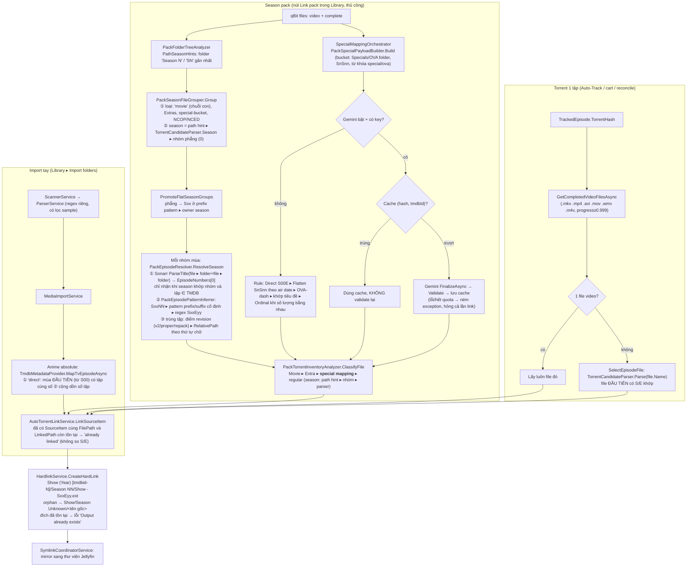

# Audit: parse file torrent → xác định show/season/tập → link vào Library

Ngày: 12/11/2026
Nhánh: `claude/parser-audit-5f9a30`, baseline commit `ff2caa3` (working tree sạch)
Thang mức độ và chuẩn bằng chứng: [00-method-and-scope.md](../00-method-and-scope.md)
Ngoài phạm vi: phần search/hunt (đang làm lại trên `feat/native-search`). Những chỗ parser dùng chung mà ảnh hưởng tới search chỉ được ghi chú ở mục 8.

## 0. Tóm tắt

- **Có 32 finding**: 10 High, 15 Medium, 7 Low. PARSE-01..15 là đợt đầu; PARSE-16 có sau khi chạy Gemini thật (mục 4a); PARSE-17..32 đến từ hai lượt đọc sâu special/Gemini và bước link (mục 11, phụ lục A và B). Phần giải thích và đề xuất cho Gemini nằm ở mục 10. Thứ tự sửa gợi ý ở cuối mục 11. Kế hoạch sửa chi tiết (20 PR, bảng truy vết đủ 32 finding) nằm ở [parser-fix-plan.md](parser-fix-plan.md). Không có Critical, vì mọi link sai đều gỡ được, không mất dữ liệu gốc và không ghi ra ngoài thư mục Library.
- Phần tốn công nhất là **pack**. Năm lỗi gây **map sai tập một cách im lặng**:
  - batch anime đánh số tuyệt đối (PARSE-01);
  - file sample thắng file chính (PARSE-02);
  - chữ "Special"/"OVA" trong tên show hoặc tên tập đẩy tập thường vào `Season Unknown` (PARSE-03);
  - folder `Season 1-3` hoặc `Season 1 Part 2` đè lên SxxEyy trong tên file (PARSE-04);
  - import tay anime số tuyệt đối tra Season 0 trước (PARSE-05).
- **Dữ liệu thật** (122 torrent, 314 file video, 299 bản ghi `SourceItems`):
  - **Không** thấy link sai trong Library hiện tại. Cả 271 link có SxxEyy đều khớp DB, folder `Season NN` và tên nguồn.
  - Harness vẫn tái hiện hai lỗi trên torrent đang có trong qBittorrent:
    - Pack `Show T … [GroupK]` (số tuyệt đối `- 01…12`) chỉ link được 9/12 tập. Tập 10 bị bỏ, tập 11 và 12 bị coi là "trùng" với E01, E02 (PARSE-01).
    - Pack Show E S1–2 chạy **chỉ bằng rule** (Gemini tắt, không có key hoặc lỗi) sẽ đẩy 7 special của S2 lệch một số: S2S01 thành S00E08, trong khi S00E08 là OVA "<OVA title>". OVA thật thì thành orphan. Library hiện đúng là nhờ Gemini (PARSE-09).
- **Lịch sử (mục 4b)**: phần lớn lỗi pack ra đời trong hai commit lớn cùng ngày 23/06 (`5b8fc83`, `af30c72`), lúc Sonarr được đặt chồng lên inferrer cũ thay vì thay thế nó. Các lần sửa sau đều chữa triệu chứng ở hạ nguồn: `63721fc` đẩy file không đọc được vào owner season, `3f5d0fd` vá dải mùa ở một chỗ, `ccca5b9` thêm tra "direct trước" cho Show L. Không có PR, issue hay bug log nào về parser. Log app chỉ còn từ 29/10 và không có lần chạy pack nào.
- **Test hiện có**: Core 248/248 pass, App 138/138 pass. Không có test nào cho `PackEpisodeResolver`, `PackTorrentInventoryAnalyzer`, `PackSpecialBucketDetector`, `PackSpecialPayloadBuilder`, `SpecialMappingOrchestrator`/cache hay `MapTvEpisodeAsync`. Danh sách test nên bổ sung ở mục 7.

## 1. Luồng dữ liệu

### Ai quyết định "file này là tập nào", theo thứ tự ưu tiên

| Luồng | Thứ tự |
|---|---|
| Torrent 1 tập | Hunt đã chọn torrent cho tập đó. Có 1 file video thì lấy luôn, không parse. Nhiều file thì lấy file **đầu tiên** mà `TorrentCandidateParser` ra đúng S/E. Không dùng Sonarr. |
| Pack, regular | **Special mapping (cache ▸ Gemini ▸ rule) thắng trước**. Sau đó mùa = **folder hint** ▸ nhóm (parser tự viết ▸ prefix Sxx ▸ owner season). Tập = **Sonarr** (`EpisodeNumbers[0]`) ▸ inferrer tự viết. Hai file cùng tập: revision ▸ **thứ tự chữ của path**. |
| Pack, special | Cache (không kiểm tra lại) ▸ Gemini ▸ rule (Direct ▸ Flatten ▸ OVA-dash ▸ Title ▸ Ordinal). Rule chạy **không qua màn review**. |
| Import tay | `ParserService` (regex riêng, **không** dùng `TorrentCandidateParser` hay Sonarr) ▸ TMDB `MapTvEpisodeAsync` cho anime absolute. |

Ghi chú tích hợp Sonarr: app chỉ gọi `Parser.ParseTitle` ở **một chỗ** ([PackEpisodeResolver.cs:80-100](../../../Services/PackEpisodeResolver.cs)), và chỉ đọc `SeasonNumber`, `EpisodeNumbers[0]`, `IsDaily`, `Special`, `FullSeason`, `IsMultiSeason`. **`AbsoluteEpisodeNumbers`, phần tử thứ hai trở đi của `EpisodeNumbers`, `SpecialAbsoluteEpisodeNumbers` và thông tin revision của Sonarr đều bị bỏ qua.** Mọi quyết định còn lại (chia nhóm mùa, special, movie, extra, file 1 tập) do ba bộ regex tự viết đảm nhận: `TorrentCandidateParser` (Core), `ParserService` (import) và `PackEpisodePatternInferrer`. Ba bộ này cho kết quả khác nhau với cùng một tên file (bảng 2).

## 2. Bảng case khó (harness, chạy code thật của app)

Cột "parser" là `TorrentCandidateParser.Parse(fileName, relativePath)`, tức đường mà pack grouping, special và chọn file 1 tập đang dùng.

| # | Case | Tên (rút gọn) | parser | parser abs=true | Sonarr | Loại/bucket | Đánh giá |
|---|---|---|---|---|---|---|---|
| 1 | Chuẩn | `Show.Name.S01E05.1080p…` | S01E05 | S01E05 | S01E[5] | – | OK |
| 2 | v2 dính số tập | `Show.Name.S01E05v2…` | **trượt** | trượt | S01E[5] | – | PARSE-07. 27 file thật (Show D, Show Y, Show E S3) |
| 3 | Multi `E01E02` | `S01E01E02` | **trượt** | trượt | E[1,2] | – | PARSE-06 |
| 4 | Multi `E01-E02` | `S01E01-E02` | S01E01 | S01E01 | E[1,2] | – | Mất E02 (PARSE-06) |
| 5 | `1x05` | | S01E05 | S01E05 | S01E[5] | – | OK |
| 6 | `Season 1 Episode 5` | | **trượt** | trượt | S01E[5] | ReleaseKind=pack | Thấp |
| 7 | PROPER / REPACK | | S01E05 | S01E05 | S01E[5] | – | OK (điểm revision 50) |
| 8 | Anime absolute | `[SubsPlease] Frieren - 05 (1080p)` | – | E05 | abs[5] | – | Pack: PARSE-01 |
| 9 | Anime v2 | `- 05v2` | – | **trượt** | abs[5] | – | |
| 10 | Anime `S2 - 05` | `[SubsPlease] Spy x Family S2 - 05` | – | **trượt** (bị coi là pack) | abs[5] | – | Mục 8 |
| 11 | Số trong tên show | `Mob Psycho 100 - 05`, `Kaiju No. 8 - 05` | – | **trượt** (dải "100 - 05" bị coi là pack) | abs[5] | – | Mục 8 |
| 12 | Số trong tên show | `[Erai-raws] 86 - Eighty Six - 05` | – | **E86** | abs[5] | – | Mục 8 |
| 13 | CJK | `[Group] 進撃の巨人 - 05`, `進撃の巨人.S01E05` | –/S01E05 | E05 | abs[5]/S01E[5] | – | OK |
| 14 | Năm là tên show | `1923.S01E03` | S01E03 | | S01E[3] | – | OK, nhưng `NormalizedTitle` rỗng |
| 15 | S00E | `Doctor.Who.2005.S00E05.Christmas.Special` | S00E05 special | | S00E[5] | – | OK |
| 16 | Daily | `The.Daily.Show.2026.11.10` | – | **E11** (tháng) | daily | – | PARSE-15 / mục 8 |
| 17 | Tên show có "Special" | `Special Ops Show/Season 1/…S01E03` | S01E03 **special** | | S01E[3] | **special-bucket** | PARSE-03 |
| 18 | Tên tập có "Special" | `Show/Season 2/…S02E07.A.Very.Special.Episode` | S02E07 **special** | | S02E[7] | **special-bucket** | PARSE-03 |
| 19 | Tên tập có "Movie" | `…S03E04.Movie.Night` | S03E04 | | S03E[4] | **movie** | PARSE-08 |
| 20 | Tên show chứa "movie" | `Moviepass.Story.S01E02` | S01E02 | | S01E[2] | **movie** | PARSE-08 |
| 21 | OVA folder | `Show/Season 1/OVA/Show.OVA.02` | special | | abs[2] | special-bucket | OK |
| 22 | SnSnn | `Show.S01S02` | special | | null | special-bucket | OK (map: PARSE-09) |
| 23 | NCOP trong Extras / không folder | `Extras/Show.NCOP.01`, `Show.NCOP01` | extra / **–** | | | extras-folder / – | `NCOP01` dính số thì không bị loại |
| 24 | Sample | `Show.S01E05.1080p/Sample/…-sample.mkv` | S01E05 | | S01E[5] | **–** | PARSE-02 |
| 25 | `Season 1 Part 2` | | S01E03 | | S01E[3] | path hint = 1 | PARSE-04 |
| 26 | Root `Season 1-3` | `Show Season 1-3 1080p/Show.S02E05` | S02E05 | | S02E[5] | path hint = **1** | PARSE-04 |
| 27 | Folder `Show.S01.1080p` + file `Show.E05` | | **trượt** | | S01E[5] | không có hint | Sonarr gỡ được |
| 28 | Tập chỉ có ở tên folder | `Show.S01E05.1080p/abc123.mkv` | trượt | | null | | Torrent 1 tập: OK nếu chỉ có 1 file |
| 29 | Phim ra Sonarr | `Spinoff…Movie.2019…`, `Movie.Two.2016…` | – | | **S20E19**, **S20E16** | movie | Sonarr đọc năm thành mùa 20. Vô hại trừ khi show có mùa 20 |
| 30 | `.ts`, `.m2ts`, `.webm`, sub/audio rời | | | | | không phải video | PARSE-13. Thật: 22 sidecar `.idx/.sub/.srt` |

Các case còn lại trong danh sách yêu cầu:
- *Nhiều version cùng tập*: PARSE-07.
- *Pack nhiều mùa*: PARSE-04 và kịch bản L (PARSE-06).
- *Đánh số khác TMDB*: PARSE-01 và PARSE-05.
- *Đường dẫn dài*: 3 file thật dài hơn 200 ký tự. `HardlinkService` dùng tiền tố `\\?\` và .NET 8 tự hỗ trợ path dài, nên không thấy lỗi.
- *Repack/proper*: OK.
- *Extras/featurette*: chỉ nhận folder `Extras` và token `NCOP`/`NCED`. Featurette, Trailer, Menu và PV nằm ngoài folder sẽ thành "Skipped" (an toàn).

## 3. Kịch bản pack (harness gọi `PackTorrentInventoryAnalyzer.Analyze` ở chế độ Link)

Special đi theo nhánh offline của `SpecialMappingOrchestrator`: `Build` → `ApplyProposals` → `Validate`. Mỗi kịch bản được chạy thêm lần nữa với thứ tự file đảo ngược. **Không kịch bản nào cho kết quả khác khi đảo**, vì thứ tự cuối cùng do sort theo path quyết định.

| Kịch bản | Kỳ vọng | Kết quả thật | Finding |
|---|---|---|---|
| A. Root `Show Season 1-3 1080p/`, file phẳng S01–S03 | 9 tập về đúng mùa | Chỉ S01E01–03 được link. **6 file S02/S03 bị "Duplicate of S01E0x"** | PARSE-04 |
| B. Root `Show.S01-S03.1080p/` (đối chứng) | 9 tập | 9 tập đúng | – |
| C. `Special Ops Show/Season 1/…S01E01..08` | 8 tập thường | **8/8 thành `UnmatchedExtra`**, link vào `Season Unknown` | PARSE-03 |
| D. Tên tập `S01E04.Movie.Night` | 6 tập | E04 thành **Movie**, bị bỏ | PARSE-08 |
| E. `Sample/Show.S01E01.sample.mkv` cạnh file chính | Lấy file chính | **Sample được link làm S01E01**, file chính bị "Duplicate" | PARSE-02 |
| F. `S01E01E02` + `S01E03` + `S01E03v2` | E01, E02, E03 (v2) | E01 lấy file đôi, **E02 thiếu**. **E03 lấy bản gốc**, v2 bị bỏ | PARSE-06, PARSE-07 |
| G. Anime absolute mùa 2 `- 13…- 24`, TMDB S2 = 1..12 | S02E01..12 | **`- 13`→S02E03, `- 14`→E04 … `- 21`→E01, `- 22`→E02**. `- 20` bị bỏ, `- 23/24` "trùng" | PARSE-01 |
| H. Batch anime mùa 1 `- 01…- 12` | S01E01..12 | E01–E09 đúng. **`- 10` bị bỏ, `- 11/12` "trùng E01/E02"** | PARSE-01 |
| I. SnSnn hai mùa, TMDB S00 có special 2010 không có trong pack | Không đoán bừa | S01S01→**S00E01 (recap 2010)**, S02S01→S00E02 | PARSE-09 |
| J. `S01E01.720p` và `1080p/S01E01.1080p` | Có chủ đích | Bản 1080p thắng, nhưng chỉ vì `"1080p/"` đứng trước `"Show…"` theo thứ tự chữ | PARSE-07 |
| K. `Season 1/` E01–03 + `Season 1 Part 2/` E01–03, TMDB S1 = 6 | Part 2 → E04–06 hoặc review | **Part 2 được link làm S01E01–03**, Part 1 bị "Duplicate" | PARSE-04 |
| L. Pack Complete có `S03E01E02`, owner S1 | S03E01, E02 | **Bỏ cả hai** ("Season mismatch (parsed S03, folder S01)") | PARSE-06 |
| M. `Season 2/…S02E07.A.Very.Special.Episode` | S02E07 thường | **`UnmatchedExtra`** | PARSE-03 |

## 4. Kết quả trên dữ liệu thật (chỉ đọc)

Nguồn:
- qBittorrent `BT_backup` (122 torrent, 462 file) và một lệnh GET `/api/v2/torrents/info` (không cần đăng nhập);
- bản copy `media-manager.db`, mở read-only;
- `gemini-mapping-cache.json`;
- danh sách tên file trong Library (590 file).

Không add hay xóa torrent, không ghi vào DB hay Library, không gọi Gemini hay TMDB.

| Kiểm tra | Kết quả |
|---|---|
| Link hiện có (`SourceItems`) so với tên nguồn, DB và folder `Season NN` | 271/271 khớp. Không có link sai |
| File video trong qBit chưa được link | 19. Trong đó **12 là pack `Show T … [GroupK]`** (show được link từ pack khác, `bcef7539`), 4 movie trong folder `Movies/` của Show E, 2 torrent lẻ thừa, 1 phim |
| Harness chạy lại pack link (rule) trên 10 pack đang track | 8 pack khớp hoàn toàn với Library. **`GroupK`: 9/12** (E10 bị bỏ, E11/E12 "trùng E01/E02"). Show E S1–2: regular 26/26, nhưng special theo rule lệch (dòng dưới) |
| Special Show E: Gemini (cache) so với rule | Gemini: S1S01–07→E01–07, S1OVA OVA M→E08, S2S01–07→E09–15 (đúng, khớp Library). **Rule: S2S01–07→E08–14 (lệch 1), OVA M thành orphan** |
| File có `v2` dính số tập | 27 file. Parser tự viết trượt hết, Sonarr gỡ được. Pack vẫn đúng nhờ Sonarr và owner fallback |
| File chứa "movie" có số tập | 1 (Spinoff Movie, là phim thật, nên không sai) |
| Sample | 1 (`Your.Name…/Sample/`). Ở torrent phim nên không đi qua `SelectEpisodeFile` |
| Sidecar sub/audio | 22 (`.idx/.sub/.srt`), không cái nào được link |
| Bản ghi phụ trợ | `MappedSeasonNumber/MappedEpisodeNumber` rỗng ở mọi dòng. Lý do skip của pack không được lưu, log chỉ còn từ 29/10 |

Phụ: subagent ghi nhận `SeriesMappings` "Show V" trỏ TMDB 82452 (bản live-action 2024), trong khi show đang track là TMDB 246. Đây là việc ngoài phạm vi parser nhưng nên kiểm tra.

## 4a. Kiểm thử Gemini thật và fuzz parser (12/11/2026)

User cho phép gọi Gemini bằng key hiện có, miễn là trong quota free. Probe chạy đúng code của app (`SpecialMappingOrchestrator` → `GeminiSpecialMappingProvider` → `GeminiApiClient`) với model đang cấu hình (`gemini-2.5-flash-lite`, fallback `gemini-2.0-flash`), có một số điều kiện riêng:
- dùng **state folder tạm**, nên cache và quota thật không bị ghi;
- `bypassCache=true`;
- `HttpMessageHandler` đếm request, có trần cứng và chặn mọi URL không phải `:generateContent`.

**Tổng cộng 6 request**, không có retry hay fallback nào bị kích hoạt.

| Ca | Rule (offline) | Gemini thật | Kết luận |
|---|---|---|---|
| Show E S1–2 thật (15 special, TMDB S00 = 32), chạy 3 lần | Đúng 7, sai 7 (S2 lệch 1), OVA không map | **Cả 3 lần sai 7/15 giống hệt nhau**: S1S01→E02 … S1S06→E07, **S1S07→E01**; S1OVA→E08 đúng; S2S01–07→E09–15 đúng. Lần 2 còn **bỏ S2S07** | PARSE-16 (mới). Library hiện đúng chỉ nhờ cache Gemini ngày 23/06 |
| Show E bỏ file S1OVA (thí nghiệm nguyên nhân) | S1 đúng, S2 lệch 1 | **S1S01–07→E01–07 đúng**; S2S01–07→E08–14 (chép y đề xuất rule, nên vẫn lệch 1) | Xác nhận nguyên nhân của PARSE-16. Gemini có xu hướng chép đề xuất Flatten (PARSE-09) |
| Show N: 8 tập thường trong `Season 1`, bị PARSE-03 đẩy sang ứng viên special; TMDB S00 = "Behind the Scenes", "Season 1 Recap" | 0/8 map (thành orphan) | **2/8 tập thường bị map vào S00** (S01E01→S00E01, S01E02→S00E02) | PARSE-03 qua Gemini thành **link sai tập**, không chỉ là orphan |
| SnSnn hai mùa, TMDB S00 có recap 2010 không nằm trong pack | S01S01→E01 (sai), S02S01→E02 (sai) | S01S01→E02, S02S01→E03 (**đúng**) | Gemini cứu được PARSE-09 khi tiêu đề TMDB đủ rõ |

Fuzz parser: 252 tên thật có SxxEyy, mỗi tên sinh 12 biến thể. Bảng ghi số tên còn giữ đúng S/E trên tổng 225 tên mà parser đọc được ở bản gốc.

| Biến thể | `TorrentCandidateParser` giữ đúng S/E | Sonarr giữ đúng |
|---|---|---|
| Đổi dấu phân cách (`.`→space/`_`), hoa/thường, `[Group]`, `[CRC]`, tag chất lượng, PROPER, năm sau tên | 225/225 | 225/225 |
| `SxxEyyv2` (v2 dính số tập) | **0/225** | 225/225 |
| `SxxEyyEzz` (multi-ep) | **4/225** | 225/225 |
| Tên tập có "Special" | 225/225, nhưng **221/225 bị gắn `IsSpecialContent`** | 225/225 |

## 4b. Lịch sử bug và hotspot

Nguồn đã đọc (chỉ đọc):
- `git log` toàn repo (150 commit), lọc theo path của parser/pack/special/Gemini/Sonarr/import/link và theo từ khóa, rồi `git show` các commit liên quan;
- `gh pr list` (PR #1–#12) và `gh issue list`;
- `debug-078d56.log` và `debug-431fbf.log` ở main checkout;
- `docs/debug/` (auto-track, torrent-hunt, pack-cleanup, unclean-exit);
- log app trong `<StateFolder>\logs` (99 file);
- bản copy read-only của DB backup `media-manager.backup-<tên>-20260612.db`.

Những nguồn không có thông tin về parser:
- Không PR hay issue nào nói về parser hay map tập. Commit message thường ngắn và không mô tả bug.
- Hai file `debug-*.log` chỉ ghi watch-status và lifecycle.
- Log app chỉ còn từ 29/10/2026 (bị dọn theo hạn). Trong đó có 4 lần link một tập (đều đúng) và không có lần chạy pack hay Gemini nào. Lý do skip của pack không được lưu vào DB, nên không dựng lại được các lần bỏ sót cũ.
- 9 file `*_crash.txt` ngày 02/11 là UncleanShutdown của `testhost.exe` (App.Tests, bản Debug ở main checkout) ghi vào state folder thật. Chuyện này không thuộc parser nhưng nên kiểm tra: test đang ghi vào `<StateFolder>`.

### Bug từng gặp và cách đã sửa

| # | Khi | Commit / nguồn | Bug | Cách sửa | Đánh giá | Finding |
|---|---|---|---|---|---|---|
| H1 | 16/05 | `d044e8c`, `ccca5b9` "update anime parser" | `ParserService` gán anime absolute thành `SeasonNumber = 1`, nên `- 1154` thành S01E1154 | Đổi thành `null`. Thêm `TmdbMetadataProvider.MapTvEpisodeAsync` (196 dòng: "direct" trước, "cộng dồn" sau). `HardlinkService` từ chối "Season 01 absolute fallback" | Vá theo một case: "direct trước" đúng với Show L (TMDB đánh số liên tục; DB backup 12/06 có 1154–1162 → S22/S23 bằng `TmdbSeasonDirect`) nhưng sai với anime đánh số theo mùa và tra cả S00. Bản backup "before-<show>-cleanup" cho thấy batch này đã phải dọn tay | PARSE-05 |
| H2 | 22/06 | `3f5d0fd` "Fix season pack cover parser" | `NormalizeText` đổi `-` thành dấu cách, làm mất dải `Seasons 1-2`/`S01-S02` | Gọi `ExtractCoveredSeasons` trên chuỗi gốc, trước khi normalize | Chữa triệu chứng: `-` vẫn bị bỏ ở mọi chỗ khác (`S01E01-E02` mất tập 2). Dải mùa được xử lý ở **ba** nơi với ba bộ quy tắc khác nhau (`ExtractCoveredSeasons`, `TorrentReleaseKind.SeasonRangeRegex`, `TryParseSeasonFolderSegment`). Bộ thứ ba không biết dải, sinh ra PARSE-04 | PARSE-04, PARSE-06 |
| H3 | 23/06 | `5b8fc83` "special/ova/extras … season pack" (+1.700 dòng) | Thêm cả tầng pack: inferrer fixed-width, folder tree, bucket special theo từ khóa, so chuỗi con "movie" | – | Nguồn gốc của PARSE-01 (fixed-width), PARSE-03 (từ khóa special/ova), PARSE-08 ("movie") | PARSE-01, 03, 08 |
| H4 | 23/06 (cùng ngày) | `af30c72` "Add Gemini api, parser from sonarr" | Thêm Sonarr (`PackEpisodeResolver`) **đặt trước** inferrer, cùng Gemini, cache và validator | – | Sonarr chỉ được dùng một phần (`EpisodeNumbers[0]`; bỏ absolute và revision). Inferrer cũ vẫn là đường dự phòng và vẫn thắng khi Sonarr ra absolute. Từ đây có **3 bộ parser chạy song song** cho cùng một file | PARSE-01, 06, 07, 09–11 |
| H5 | 13/08 | `63721fc` "fix inspect pack bug for flat torrent" | File mà `TorrentCandidateParser` không đọc được rơi vào nhóm phẳng (mùa 0) và không được link. Dạng tên đúng như các pack `[smol] … - S01E01v2 … [CRC]` (Show D, Show Y) đang có trong qBit | Bỏ CRC khỏi stem. Đẩy nhóm phẳng sang Sxx ở prefix hoặc **owner season** | Chữa triệu chứng: nguyên nhân gốc (regex đòi `\b` sau số tập nên trượt `v2`/`E01E02`) vẫn còn. Fallback owner season gán mọi file không đọc được vào mùa owner, rồi đụng Sonarr ("Season mismatch") ở pack nhiều mùa (kịch bản L) | PARSE-06, 07 |
| H6 | 22–23/08 | `687d6f3`, `48e03d6` Sprint 1/3: tách Core, "freeze parser behavior" | – | 20 + 80 test, golden fixture `pack-stems.json` | Test **đóng băng cả hành vi lỗi**: fixture fixed-width chỉ có `- 01..03`, không có case qua mốc 09→10, mùa 2 đánh số tiếp, sample, multi-ep hay "Special" trong tên. `PackEpisodeResolver`, `PackTorrentInventoryAnalyzer` và special pipeline ở lại project App, không có test | PARSE-01, mục 7 |
| H7 | 03–16/09 | `8ce1b1c`, `8657f65`, `26d1476`; `docs/debug/pack-cleanup/<show>-s06-2026-09-03.md` | Unlink/Cleanup pack xóa link trên đĩa nhưng để lại `SourceItems`, nên availability vẫn 16/16 | Bắt cờ provenance của pack, dọn theo khóa tập, thêm `SeasonPackCleanupMatcher` (có test) | Cùng gốc với PARSE-12: danh tính link là `FilePath` cộng cờ trên `SourceItem`, không phải (mùa, tập). Link lại hay sửa map vẫn không tự đồng bộ | PARSE-12 |
| H8 | 23/06 → 04/08 | `2f2c55d`, `71873d2` | Thêm token chất lượng (`1440p`, rồi `2160`, `1080`, `720`, `480`, `4k`, `uhd`…) vào `ReleaseTokenRegex` để chấm điểm search | – | Sửa cho search nhưng regex dùng chung: `NormalizeTitle` của mọi luồng giờ xóa các số `480/720/1080/2160` trong tên show. Rủi ro thấp, nhưng cho thấy parser dùng chung bị sửa theo nhu cầu của search | Ghi chú mục 6 |

Hai torrent cho cùng một show (Show T), user xác nhận đã tải cả hai:
- `[GroupK]` (số tuyệt đối `- 01…12`) được add lúc 18:58 ngày 13/08, nhưng tới 07:52 sáng 14/08 mới tải xong. Không có cart order nào cho torrent này.
- `[GroupN]` (tên `S01Exx`) được đặt qua cart lúc 19:19 cùng ngày (order #170) và tải xong sau 3 phút. Library đang link từ pack này.

Lúc GroupN được đặt, GroupK chưa tải xong, nên chưa thể có lần link pack nào trên GroupK. User xác nhận (12/11) đã đổi sang GroupN vì GroupK tải chậm, và chỉ không xóa GroupK; việc đổi không liên quan tới PARSE-01. PARSE-01 trên GroupK chỉ được chứng minh bằng harness. Commit `63721fc` (sửa inspect pack phẳng) cũng ra đời ngày 13/08, nhưng dữ liệu không đủ để nối nó với hai torrent này.

### Hotspot (số commit chạm file, theo tên file trên toàn lịch sử)

| File | Commit | Ghi chú |
|---|---|---|
| `TmdbMetadataProvider.cs` | 14 | Đa số là mạng/WARP. Phần mapping absolute chỉ đổi một lần (H1) |
| `AutoTorrentLinkService.cs` | 12 | Link, unlink, cleanup, pack. Sửa nhiều nhất trong luồng link (H5, H7) |
| `TorrentCandidateParser.cs` | 10 | Dùng chung cho search và link. Phần lớn là tinh chỉnh token cho search (H2, H8) |
| `HardlinkService.cs`, `TorrentReconciliationService.cs` | 8, 8 | |
| `ParserService.cs` | 5 | Bộ parser thứ ba, chỉ cho import tay |
| `PackTorrentInventoryAnalyzer.cs`, `PackEpisodePatternInferrer.cs` | 4, 4 | Một lần viết lớn (H3) và một lần vá (H5). Không có test cấp App |

Ưu tiên audit sâu tiếp theo:
1. `TorrentCandidateParser` cùng `NormalizeText`: dùng chung cho search và link, bị sửa nhiều lần theo từng case, là nguồn gốc của PARSE-03, 04, 06, 07.
2. Cặp `PackEpisodeResolver` và `PackEpisodePatternInferrer`: ba tầng parser chồng nhau, chưa có test.
3. `AutoTorrentLinkService` cùng `SourceItem` identity (PARSE-12, H7).

## 5. Findings

### PARSE-01 — High — Batch anime đánh số tuyệt đối bị map sai hoặc bỏ tập trong pack

Liên quan: H3 (`5b8fc83` thêm inferrer fixed-width), H4 (`af30c72` bỏ qua absolute của Sonarr), H6 (fixture chỉ có `- 01..03`). Dữ liệu thật: pack `GroupK`.

Code:
- [PackEpisodeResolver.cs:103-108, 170-194](../../../Services/PackEpisodeResolver.cs): `HasSeasonEpisode`/`TryExtractFromParsed` chỉ nhận `EpisodeNumbers`. File anime `- 05` thì Sonarr trả `AbsoluteEpisodeNumbers=[5]`, `EpisodeNumbers=[]`, nên kết quả của Sonarr bị bỏ.
- [PackEpisodePatternInferrer.cs:131-176](../../../MediaManager.Core/Services/PackEpisodePatternInferrer.cs): suy luận "prefix/suffix cố định" từ các cặp tên liền nhau, rồi lấy pattern được nhiều phiếu nhất. Khi số tập vượt mốc 2 chữ số (`09`→`10`) hoặc mùa bắt đầu từ `13`, pattern thắng có prefix dài hơn một ký tự (`"… - 0"` hoặc `"… - 1"`). `TryExtractFixedWidth` vì vậy chỉ đọc **chữ số cuối**.
- Dòng 165-173: `ValidatePattern` có loại pattern này (ra tập 0, hoặc vượt số tập), nhưng sau đó `return TryStandardEpisodeBootstrap(...) ?? pattern;` **vẫn trả về chính pattern vừa trượt validate**.
- [PackEpisodeResolver.cs:42-57](../../../Services/PackEpisodeResolver.cs): các file đọc ra cùng số tập bị gộp thành "Duplicate". Không có giới hạn offset, cũng không quy đổi absolute sang tập trong mùa.

Bằng chứng: kịch bản G và H. Dữ liệu thật: pack `c14985ce` (`Show T - 01..12 [GroupK]`) chỉ link E01–E09, `- 11`/`- 12` bị coi là trùng E01/E02. Mùa 2 trở đi đánh số liên tục (13–24) thì **link sai tập** (`- 13`→S02E03).

Tác động: dạng pack anime phổ biến nhất (batch SubsPlease, Erai, GroupK; mùa 2 đánh số liên tục) sẽ mất tập từ 10 trở đi, hoặc link sai tập mà không báo lỗi. Có thể vòng qua bằng cách chọn pack có SxxEyy, đúng như user đã làm với Show T. Độ tin cậy cao, đã tái hiện.

Hướng sửa:
1. Dùng `AbsoluteEpisodeNumbers` của Sonarr khi `EpisodeNumbers` rỗng. Quy đổi absolute sang (mùa, tập) bằng tổng số tập TMDB của các mùa trước. Nếu absolute đã nằm trong khoảng 1..N của mùa thì giữ nguyên.
2. `Infer` không được trả pattern đã trượt validate. Trả `Invalid` để file rơi vào "Skipped" thay vì map bừa.
3. Ưu tiên pattern "số ở cuối sau dấu `-`" (`- NN`) thay cho vote prefix theo độ dài cố định.

### PARSE-02 — High — File sample không bị loại khi link từ torrent; sample có thể thắng file chính

Liên quan: Không có commit nào xử lý sample trong luồng torrent. Lọc `sample|proof` được thêm vào `ParserService` ở `d044e8c` (16/05) cho import tay, nhưng không bao giờ được đưa sang `TorrentCandidateParser` hay luồng pack (H3, H4).

Code:
- [TorrentContentFile.cs:17-29](../../../MediaManager.Core/Models/TorrentContentFile.cs) chỉ lọc theo đuôi file.
- Không có quy tắc sample nào trong `PackSeasonFileGrouper`, `PackEpisodeResolver` hay `AutoTorrentLinkService.SelectEpisodeFile` ([AutoTorrentLinkService.cs:1143-1155](../../../Services/AutoTorrentLinkService.cs)).
- Lọc `sample|proof` chỉ có trong `ParserService.ShouldIgnore`, mà hàm này chỉ dùng cho import tay.
- Tie-break ở [PackEpisodeResolver.cs:44-47](../../../Services/PackEpisodeResolver.cs) là `ThenBy(RelativePath)`, không xét dung lượng (dung lượng còn bị bỏ: `files` chỉ có tên).

Bằng chứng: kịch bản E. `Show.S01.1080p/Sample/Show.S01E01.sample.mkv` thắng `Show.S01.1080p/Show.S01E01.1080p.mkv`, vì `"Sample/"` < `"Show."`. Với torrent 1 tập có folder `Sample/`, `SelectEpisodeFile` lấy file **đầu tiên** parse ra đúng S/E. Torrent thường xếp file theo chữ cái, nên sample hay đứng trước.

Tác động: Library nhận clip vài chục giây thay cho tập phim, kèm thông báo "Linked". Dữ liệu hiện tại có 1 sample (ở torrent phim), chưa dính. Độ tin cậy cao, đã tái hiện trên pack. Đường 1 tập được chứng minh tĩnh.

Hướng sửa: loại file có segment hoặc từ `sample`/`proof` ngay ở bước lấy file (`GetCompletedVideoFilesAsync` và pack). Tie-break theo dung lượng, giữ `Size` từ qBit thay vì vứt đi.

### PARSE-03 — High — Chữ "Special"/"OVA" ở tên show hoặc tên tập biến tập thường thành special hoặc orphan

Liên quan: H3 (`5b8fc83` thêm bucket special theo từ khóa). Chưa có bug log.

Code:
- [TorrentCandidateParser.cs:225-234, 371-372](../../../MediaManager.Core/Torrent/TorrentCandidateParser.cs): `IsSpecialContent = true` khi tên file có từ `special(s)` hoặc `ova(s)` ở **bất kỳ đâu**, kể cả khi đã có `SxxEyy` hợp lệ.
- [PackSpecialBucketDetector.cs:139-194](../../../MediaManager.Core/Services/PackSpecialBucketDetector.cs): có `IsSpecialContent` cộng season hint từ folder là đủ để thành bucket `MixedInSeason`.
- [PackSeasonFileGrouper.cs:81-84](../../../MediaManager.Core/Services/PackSeasonFileGrouper.cs): file trong bucket bị loại khỏi nhóm tập thường.
- [PackTorrentInventoryAnalyzer.cs:491-515](../../../Services/PackTorrentInventoryAnalyzer.cs): special mapping được xét **trước** regular.
- [AutoTorrentLinkService.cs:735-741](../../../Services/AutoTorrentLinkService.cs): `UnmatchedExtra` được link thành orphan vào `Season Unknown/`. Khi Gemini bật, các file này còn được gửi đi như ứng viên S00.

Bằng chứng: kịch bản C (`Special Ops Show`, 8/8 tập thành orphan) và M (`S02E07.A.Very.Special.Episode`). Bảng case #17, #18. Gemini thật (mục 4a): **2/8 tập thường bị map vào S00E01/E02**. Fuzz: 221/225 tên thật bị gắn special chỉ vì thêm "Special" vào tên tập.

Tác động: tập thường mất khỏi mùa của nó, bị link vào `Season Unknown` hoặc (qua Gemini) bị map thành S00Exx. Chỉ xảy ra khi pack có folder `Season N`. Show đang track hiện chưa dính. Độ tin cậy cao, đã tái hiện.

Hướng sửa: khi tên file có `SxxEyy` với `xx > 0` (hoặc Sonarr ra `EpisodeNumbers`), **không** gắn special theo từ khóa. Chỉ dùng từ khóa cho file không có số tập, hoặc khi từ khóa đứng ngay trước hay sau số (`OVA 02`, `Special 1`).

### PARSE-04 — High — Season hint từ tên folder đè lên SxxEyy trong tên file

Liên quan: H2 (`3f5d0fd` vá dải mùa ở một chỗ, folder hint không được sửa theo).

Code:
- [TorrentCandidateParser.cs:261-312](../../../MediaManager.Core/Torrent/TorrentCandidateParser.cs): `TryParseSeasonFolderSegment` khớp `Season\s*N` ở bất kỳ đâu trong segment, nên `Show Season 1-3 1080p` ra 1. Nó cũng bỏ qua phần `Part 2`, nên `Season 1 Part 2` ra 1. `TryGetSeasonHintFromPath` lấy luôn cả root folder.
- [PackSeasonFileGrouper.cs:30-44](../../../MediaManager.Core/Services/PackSeasonFileGrouper.cs) và [PackTorrentInventoryAnalyzer.cs:631-650](../../../Services/PackTorrentInventoryAnalyzer.cs): path hint thắng tên file.
- Trong nhóm mùa sai, Sonarr báo lệch mùa ([PackEpisodeResolver.cs:187-190](../../../Services/PackEpisodeResolver.cs)). Code rơi xuống inferrer, mà inferrer không biết Sonarr vừa nói mùa khác, nên vẫn trích ra số tập theo vị trí ký tự.

Bằng chứng: kịch bản A (6/9 file của S02/S03 bị "Duplicate of S01E0x") và K (Part 2 được link làm S01E01–03, Part 1 bị bỏ).

Tác động: pack nhiều mùa đặt tên kiểu `Season 1-3` mất cả các mùa sau. Pack có `Part 2` đánh số lại thì **link sai tập**. Bên thắng trong cặp "trùng" do thứ tự chữ quyết định, nên file mùa khác có thể bị link vào mùa 1. Độ tin cậy cao, đã tái hiện.

Hướng sửa:
- Folder hint chỉ áp khi segment là một mùa đơn (`Season 01`, `S01`, `Season 1` ở cuối segment). Bỏ qua dải `1-3`, `1~3`, `Seasons`.
- `SxxEyy` hợp lệ trong tên file thắng folder hint.
- Gặp `Part N` thì không gộp vào nhóm mùa, hoặc đánh dấu cần review.
- Khi Sonarr ra mùa khác nhóm, đừng chạy inferrer cho file đó.

### PARSE-05 — High — Import tay anime absolute: TMDB mapping tra Season 0 trước và "khớp số" thay vì cộng dồn

Liên quan: H1 (`ccca5b9`: "direct trước" được thêm cho Show L; DB backup 12/06 có 1154–1162 qua `TmdbSeasonDirect`). Khi sửa phải giữ được case Show L.

Code: [TmdbMetadataProvider.cs:729-748](../../../Services/TmdbMetadataProvider.cs) duyệt các mùa theo `OrderBy(SeasonNumber)`, bắt đầu từ **0** (dòng 870-871). Mùa đầu tiên có một tập mang số bằng số tuyệt đối thì được trả về với `Confidence = 100`. Phương án cộng dồn (dòng 750-775) chỉ chạy khi không mùa nào có số đó. Kết quả được [MediaImportService.cs:219-228, 303-321](../../../Services/MediaImportService.cs) ghi vào `MappedSeason/EpisodeNumber` và `HardlinkService.BuildOutputPath` dùng làm đích.

Bằng chứng (tĩnh, cần TMDB thật nên không chạy):
- `[Group] Show - 03.mkv` của một show có ≥3 special sẽ ra **S00E03**.
- Show có S1 = 12, S2 = 12, S3 = 24 tập: absolute 15 ra **S03E15** thay vì S02E03.

Tác động: import tay anime số tuyệt đối có thể vào Season 00 hoặc sai mùa, với confidence 100 nên không bị gắn cần review. Chỉ ảnh hưởng luồng import tay. Trong DB hiện tại `MappedSeasonNumber` rỗng ở mọi dòng, nên chưa dính. Độ tin cậy cao về logic.

Hướng sửa: bỏ Season 0 khỏi mọi bước của mapping absolute. Ưu tiên cộng dồn. Chỉ dùng "khớp số trực tiếp" khi TMDB của mùa đó thực sự đánh số liên tục (tập đầu của mùa có số lớn hơn 1).

### PARSE-06 — Medium — File nhiều tập chỉ map tập đầu, hoặc bị bỏ hẳn

Liên quan: H2 (`-` bị normalize), H5 (`63721fc` gán file không đọc được vào owner season), H4 (chỉ lấy `EpisodeNumbers[0]`).

Code:
- [PackEpisodeResolver.cs:192](../../../Services/PackEpisodeResolver.cs) chỉ lấy `EpisodeNumbers[0]`.
- `TorrentCandidateParser.EpisodeRegex` ([TorrentCandidateParser.cs:44-46](../../../MediaManager.Core/Torrent/TorrentCandidateParser.cs)) cần `\b` sau số tập, nên `S01E01E02` trượt hoàn toàn và file rơi vào nhóm phẳng.
- [HardlinkService.cs:52](../../../Services/HardlinkService.cs) đặt tên đích bằng một `SxxEyy` duy nhất.

Bằng chứng: fuzz cho thấy `SxxEyyEzz` làm parser trượt 221/225 tên thật. Kịch bản F (E02 thiếu) và L (pack nhiều mùa: `S03E01E02` bị gán owner S01, rồi bị bỏ vì "Season mismatch"). Torrent 1 tập nhiều file có tên `E01E02` thì `SelectEpisodeFile` không tìm được file.

Tác động: tập thứ hai luôn bị coi là thiếu (Auto-Track có thể hunt lại một cách vô ích). Nếu pack nhiều mùa thì mất cả hai tập.

Hướng sửa: đặt tên đích `SxxEyy-Ezz` (Jellyfin hiểu) và đánh dấu mọi tập trong `EpisodeNumbers` là có. Sửa regex parser cho `E01E02` và `E01-E02`.

### PARSE-07 — Medium — Chọn giữa nhiều bản của cùng tập không đáng tin (v2 dính số, chất lượng)

Liên quan: H5 (`63721fc`: file `S01E01v2` của các pack smol được cứu nhờ owner fallback, regex gốc chưa sửa). Dữ liệu thật: 27 file `v2` dính số tập.

Code: `RevisionRegex` ([PackEpisodeResolver.cs:10-12](../../../Services/PackEpisodeResolver.cs)) đòi ký tự không phải chữ hay số đứng trước `v`, nên `E03v2` và `- 05v2` không được cộng điểm. Khi hòa điểm, bên thắng do `RelativePath` theo thứ tự chữ quyết định. Code không xét chất lượng hay dung lượng.

Bằng chứng: kịch bản F (bản gốc thắng `S01E03v2`) và J. Fuzz: thêm `v2` sau SxxEyy làm parser trượt **225/225** tên thật, còn Sonarr giữ đúng cả 225. Dữ liệu thật có 27 file `SxxEyyv2`. Các pack đó chỉ có bản v2 nên chưa dính.

Hướng sửa: nhận `v\d` ngay sau số tập. Hòa điểm thì ưu tiên chất lượng (`TorrentQuality.Detect`), rồi dung lượng. Ghi log bản bị loại.

### PARSE-08 — Medium — Chuỗi con "movie" loại tập thường khỏi pack

Liên quan: H3 (`5b8fc83`).

Code: `fileName.Contains("movie", OrdinalIgnoreCase)` ở [PackSeasonFileGrouper.cs:70-74](../../../MediaManager.Core/Services/PackSeasonFileGrouper.cs), [PackTorrentInventoryAnalyzer.cs:652-659](../../../Services/PackTorrentInventoryAnalyzer.cs) và [PackSpecialBucketDetector.cs:48-52](../../../MediaManager.Core/Services/PackSpecialBucketDetector.cs). Đây là so chuỗi con, không phải so từ (`PackContentAnalyzer` thì so từ).

Bằng chứng: kịch bản D (`S01E04.Movie.Night` thành Movie) và bảng case #19, #20 (`Moviepass`). Dữ liệu thật chưa dính.

Hướng sửa: chỉ coi là movie khi nằm trong folder `Movies`/`Films`, hoặc có từ `Movie`/`Film` mà **không** có `SxxEyy`.

### PARSE-09 — Medium — Rule special (Flatten/Ordinal) được áp mà không qua review và có thể lệch số

Liên quan: H4 (`af30c72`). Dữ liệu thật: so sánh cache Gemini và rule của Show E.

Code:
- [PackSpecialPayloadBuilder.cs:299-329](../../../Services/PackSpecialPayloadBuilder.cs): Flatten gán SnSnn lần lượt theo air date của toàn bộ S00, kể cả special không có trong pack.
- Dòng 400-432: Ordinal.
- [SpecialMappingOrchestrator.cs:81-89](../../../Services/SpecialMappingOrchestrator.cs): đường offline.
- [AutoTorrentLinkService.cs:637](../../../Services/AutoTorrentLinkService.cs): `RequiresReview` chỉ bật khi đã dùng Gemini.

Bằng chứng:
- Dữ liệu thật: pack Show E S1–2 chạy bằng rule ra S2S01–07 thành S00E08–14 (sai, phải là E09–15), và OVA "<OVA title>" (S00E08) thành orphan.
- Kịch bản I: S01S01 thành S00E01, tức một recap năm 2010 không có trong pack. Gemini thật map đúng ca này (E02, E03).
- Gemini thật **chép lại đề xuất Flatten** khi không có OVA làm mốc (Show E bỏ OVA: S2 vẫn lệch 1). Gemini vì vậy không phải lớp sửa lỗi đáng tin cho PARSE-09.

Tác động: tắt Gemini, hết key, hoặc bấm "Link pack (rules only)" sẽ link sai special mà không có màn review nào.

Hướng sửa: Flatten/Ordinal chỉ được làm đề xuất, hoặc phải qua review như Gemini. Hoặc chỉ cho Flatten chạy khi số SnSnn mỗi mùa khớp đúng một khối liên tục trong S00.

### PARSE-10 — Medium — Gemini lỗi hay hết quota làm hỏng cả lần link pack, gồm cả tập thường

Liên quan: H4 (`af30c72`).

Code:
- [SpecialMappingOrchestrator.cs:116-123](../../../Services/SpecialMappingOrchestrator.cs) gọi `FinalizeAsync` mà không có fallback.
- [GeminiSpecialMappingProvider.cs:213-237](../../../Services/Gemini/GeminiSpecialMappingProvider.cs) ném exception khi parse lỗi.
- `GeminiApiClient` ném khi mọi model fallback đều hỏng.
- `SpecialMappingValidator` ném khi Gemini trả hai file cho cùng một S00E.
- [PackSpecialPayloadBuilder.cs:506-509](../../../Services/PackSpecialPayloadBuilder.cs): `ToDictionary` ném `ArgumentException` khi Gemini lặp `candidateIndex`.
- Exception đi lên [LibraryViewModel.cs:993-998](../../../ViewModels/LibraryViewModel.cs) và chỉ hiện "Pack link failed".

Tác động: các tập thường đã map xong bằng rule ([AutoTorrentLinkService.cs:589-596](../../../Services/AutoTorrentLinkService.cs)) cũng không được link. User phải tự chạy lại ở chế độ rules-only, và chế độ đó lại dính PARSE-09. Độ tin cậy cao (tĩnh).

Hướng sửa: khi Gemini lỗi, rơi về rule cộng với review. Bỏ qua (kèm cảnh báo) cặp trùng thay vì ném. Tách link tập thường khỏi bước special.

### PARSE-11 — Medium — Cache Gemini không được kiểm tra lại; số S00 cũ có thể link nhầm hoặc biến mất không báo

Liên quan: H4 (`af30c72`). Cache thật: 1 entry Show E, 23/06/2026.

Code:
- [SpecialMappingOrchestrator.cs:98-114](../../../Services/SpecialMappingOrchestrator.cs): cache trúng thì trả luôn, không `Validate`. Key chỉ gồm `(hash, tmdbId)` ([SpecialMappingCache.cs:220-221](../../../Services/SpecialMappingCache.cs)).
- Cache lưu snapshot `TrackedEpisode` ([PackTorrentInventoryAnalyzer.cs:395-409](../../../Services/PackTorrentInventoryAnalyzer.cs)). Bước link tra lại theo **số** ([AutoTorrentLinkService.cs:742-746](../../../Services/AutoTorrentLinkService.cs)).
- Nếu TMDB đánh số lại S00 thì file vào special mới mang số đó. Nếu số đó không còn thì `switch` không có `default`, nên file **bị bỏ mà không có thông báo skip nào**.
- Kết quả bị user từ chối ở màn review vẫn nằm trong cache.
- `_entries` là `Dictionary` không có lock.

Dữ liệu thật: cache hiện có 1 entry (Show E, 23/06/2026). TMDB S00 của show này đã có thêm E16–32, và các số cũ vẫn trùng nên chưa dính.

Hướng sửa: khi cache trúng, chạy `Validate` và so tiêu đề hoặc air date với S00 hiện tại. Trượt thì coi như cache miss. Thêm hash của danh sách S00 vào key.

### PARSE-12 — Medium — Link lại không sửa được link sai; trạng thái "already linked" che khác biệt S/E

Liên quan: H7 (`8ce1b1c`, `8657f65`, `26d1476`; ghi chú debug Show H S06). Cùng gốc: danh tính link theo `FilePath`.

Code: [AutoTorrentLinkService.cs:858-876, 939-951](../../../Services/AutoTorrentLinkService.cs). Có một `SourceItem` cùng `FilePath` mà `LinkedPath` còn tồn tại là đủ để báo "already linked". Code chỉ cập nhật provenance, không so `Season/EpisodeNumber` mới với cũ.

Tác động: sau khi sửa mapping (retry Gemini, hay vá parser), bấm Link lại vẫn giữ link sai. User phải biết mà gỡ pack link trước. Những lỗi ở trên vì vậy cũng không tự lành.

Hướng sửa: nếu S/E khác bản ghi cũ thì báo rõ "mapping changed", rồi gỡ và tạo lại (hoặc hỏi user). Harness ở phụ lục B (PARSE-24) cho thấy hậu quả cụ thể khi cờ orphan/special bị lật mà S/E giữ nguyên.

### PARSE-13 — Low — Bỏ sót `.ts`/`.m2ts`/`.webm` và sub/audio rời

Liên quan: Danh sách đuôi video có từ phase 1. Chưa có bug log.

Code: [TorrentContentFile.cs:17-29](../../../MediaManager.Core/Models/TorrentContentFile.cs). Danh sách đuôi video cũng khác danh sách của `TorrentMetadataProbeResult` (thiếu `.wmv`). Sidecar (`.srt/.ass/.idx/.sub/.mka`) không bao giờ được link. Dữ liệu thật có 22 sidecar.

Hướng sửa: thống nhất một danh sách đuôi. Nếu muốn có sub, link sidecar có cùng stem theo tên đích. Theo chính sách không thêm tính năng, mục này để user quyết.

### PARSE-14 — Low — Orphan extras gom theo tên gốc vào một folder

Liên quan: Hằng số `OrphanExtrasFolderName = "Season Unknown"` có từ H3/H7. Dữ liệu thật: 16 orphan.

Code: [HardlinkService.cs:40-44](../../../Services/HardlinkService.cs). Mọi orphan vào `Show/Season Unknown/<tên gốc>`. Hai file cùng tên ở hai mùa (`Season 1/NCOP.mkv`, `Season 2/NCOP.mkv`) thì file thứ hai báo "Output already exists". Ghi chú của `AppConstants.OrphanExtrasFolderName` nói "Jellyfin extras folder", nhưng `Season Unknown` không phải tên folder extras mà Jellyfin nhận diện. Dữ liệu thật có 16 orphan NCOP/NCED.

### PARSE-15 — Low — Daily show không được link qua pack; Inspect đếm sai

Liên quan: H4 (`af30c72`).

Code:
- [PackEpisodeResolver.cs:132-135](../../../Services/PackEpisodeResolver.cs) bỏ mọi daily release ("not matched to TMDB episode number"). Không có quy đổi ngày sang tập qua `AirDate`.
- Chế độ Inspect ([PackTorrentInventoryAnalyzer.cs:598-605](../../../Services/PackTorrentInventoryAnalyzer.cs)) đếm file không ra số tập là `RegularEpisode`, nên tóm tắt Inspect của pack lạc quan hơn kết quả Link.

### PARSE-16 — High — Payload Gemini xếp special không có số lên đầu, làm Gemini map lệch cả khối special (đã tái hiện bằng Gemini thật)

Liên quan: H4 (`af30c72`), PARSE-09. Bằng chứng ở mục 4a.

Code: [PackSpecialPayloadBuilder.cs:182-221, 437-458](../../../Services/PackSpecialPayloadBuilder.cs).
- `BuildCandidateMetadata` gán `LocalIndex = 0` cho file special không có số. Ví dụ `S1OVA - <OVA title>`: nhận dạng ra `Opaque`, không có `ReleaseSpecialIndex`.
- Ứng viên được sort theo `ParentSeason` rồi `LocalIndex`, nên file OVA đứng **trước** S1S01.
- `GlobalSortOrder` đánh lại từ 1, vậy S1S01…S1S07 nhận `globalSort` 2…8.
- System prompt yêu cầu "prefer chronological TMDB order", và Gemini bám theo `globalSort`, nên S1S01→E02 … S1S06→E07. E08 bị OVA lấy theo tiêu đề ("<OVA title>"), còn S1S07 nhận phần dư là E01.

Bằng chứng: chạy 3 lần trên pack Show E thật với `gemini-2.5-flash-lite` (12/11), cả 3 lần sai đúng 7/15 theo cùng một kiểu. Bỏ riêng file OVA thì S1 được map đúng. Lần chạy thứ 2 còn bỏ sót S2S07, tức output không ổn định giữa các lần gọi. Cache ngày 23/06 của pack này lại đúng. Lý do có thể là model hoặc dữ liệu TMDB khác lúc đó; không kiểm chứng được.

Tác động:
- Bấm Retry ở màn review (`bypassCache`) hoặc link một pack mới có special không đánh số, cộng thêm các special đánh số, sẽ cho mapping sai trông rất hợp lý.
- Màn review là lớp chặn duy nhất, mà 15 dòng `S1S07 → S00E01` khó nhận ra là sai nếu không so tiêu đề.
- Kết hợp với PARSE-11, một kết quả sai đã được Accept sẽ nằm vĩnh viễn trong cache.

Hướng sửa:
- Đặt ứng viên `Opaque`/`LocalIndex=0` **sau** các ứng viên có số trong cùng block, hoặc không gửi `globalSort` cho chúng.
- Gửi `localIndex` và tiêu đề TMDB rõ ràng, sửa prompt để ưu tiên chỉ số SnSnn trong block hơn thứ tự toàn cục.
- Sau khi Gemini trả lời, kiểm tra mapping có giữ thứ tự `LocalIndex` trong mỗi block không. Nếu đảo thứ tự thì cảnh báo trong review.
- Thêm test với cây Show E thật, dùng response giả theo đúng kiểu sai đã thấy.

## 6. Ghi chú review (chưa đủ chuẩn finding)

- `TorrentCandidateParser.CompactSeasonEpisodeSuffixRegex` (`S(\d{1,2})(\d{1,4})$`) không có `\b` đầu và lấy tham lam, nên `S1012` ứng với mùa 10. Chưa gặp trên dữ liệu thật.
- Sonarr đọc năm của tên phim thành mùa 20 (`S20E19`, bảng case #29). Chỉ thành vấn đề nếu show có mùa ≥ 20 và pack có phim không mang chữ "movie".
- `TorrentMetadataReader` không đọc torrent v2-only (`file tree`). Khi đó nó trả về một file với length 0. Dữ liệu thật không có torrent v2.
- `NormalizedTitle` của show có tên là năm (`1923`) bị xóa thành rỗng. Ảnh hưởng ở phía search/khớp tiêu đề.
- `ReleaseTokenRegex` (dùng chung) đã được mở rộng cho search với các số trần `480/720/1080/2160` (H8). `NormalizeTitle` giờ xóa các số này khỏi tên show ở mọi luồng.
- `LastPackLinkTorrentHash` là NULL cho Show K S1–4 và Show E S2 dù các file đã được link (theo subagent). Chỉ ảnh hưởng cooldown của Inspect.

## 7. Test còn thiếu nên bổ sung

Ưu tiên theo finding. Fixture có thể đặt ở `MediaManager.Core.Tests/Fixtures/pack-file-trees.json`. Phần pack nằm trong project App nên cần test ở `MediaManager.App.Tests`.

1. `PackTorrentInventoryAnalyzer` (Link) với batch anime `- 01..12` và `- 13..24` (mùa 2). Kỳ vọng đủ 12 tập đúng số (PARSE-01). Dùng danh sách file thật của pack `GroupK`.
2. `PackEpisodePatternInferrer.Infer` không trả pattern đã trượt `ValidatePattern` (PARSE-01).
3. Pack có `Sample/…sample.mkv`, và `SelectEpisodeFile` với torrent 1 tập có sample (PARSE-02).
4. Show hoặc tập có chữ Special/OVA trong folder `Season N`: phải ra `RegularEpisode` (PARSE-03).
5. Root `Show Season 1-3` và `Season 1 Part 2` (PARSE-04).
6. `MapTvEpisodeAsync` với S00 nhiều tập và các mùa độ dài khác nhau, dùng `HttpMessageHandler` giả (PARSE-05).
7. Multi-episode `E01E02`, `E01-E02` qua parser, pack và tên đích (PARSE-06).
8. `S01E03` + `S01E03v2`, và 720p + 1080p cùng tập (PARSE-07).
9. Tên tập có "Movie" (PARSE-08).
10. Rule special trên cây Show E thật (S1S01–07, S1OVA, S2S01–07, TMDB S00 có 32 tập): không được lệch số (PARSE-09).
11. Orchestrator: Gemini ném lỗi, trả trùng `candidateIndex` hoặc trùng S00E. Kỳ vọng tập thường vẫn link (PARSE-10).
12. Cache trúng nhưng S00 đã đổi số hoặc bị xóa (PARSE-11).
13. Link lại một `SourceItem` với S/E khác (PARSE-12).
14. Một test bất biến: đảo thứ tự file đầu vào không làm đổi kết quả. Hiện đang ổn, nên khóa lại.
15. Golden test chạy `TorrentCandidateParser` và Sonarr trên toàn bộ 314 tên file thật, đánh dấu chỗ hai bên lệch nhau.

## 8. Ghi chú cho phiên search (`feat/native-search`)

`TorrentCandidateParser.Parse(..., allowAnimeAbsolute: true)` được dùng trong hunt (`CandidateEvaluationService`, `FetchJobService` lọc metadata). Harness cho thấy:
- `Spy x Family S2 - 05`, `Mob Psycho 100 - 05` và `Kaiju No. 8 - 05` **không ra số tập**, vì bị coi là pack;
- `86 - Eighty Six - 05` ra **tập 86**;
- daily `2026.11.10` ra **tập 11**.

Những lỗi này ảnh hưởng tới việc lọc hoặc chấm ứng viên anime, không ảnh hưởng bước link.

## 9. Cách tái hiện

- Harness (không nằm trong repo): bản sao ở thư mục ghi chú chung của nhóm phiên, `side-session-notes/<phiên gốc>/parser-audit-harness/` (gồm `Program.cs`, `harness.csproj`, `build_ctx.py` và output). Nó tham chiếu các DLL do `MediaManager.App.Tests` build ra (`media management app.dll`, `MediaManager.Core.dll`, `MediaManager.Sonarr.Parser.dll`) và có hai chế độ:
  - `synthetic` sinh bảng ở mục 2 và 3;
  - `real <torrents.json> <pack_contexts.json>` sinh mục 4.
- Dữ liệu thật đọc từ `%LOCALAPPDATA%\qBittorrent\BT_backup` và bản copy của `<StateFolder>\media-manager.db` (mở read-only).
- Test:
  - `dotnet test MediaManager.Core.Tests -c Release`: 248 pass;
  - `dotnet test MediaManager.App.Tests -c Release -p:Platform=x64`: 138 pass.
  - probe Gemini: `parser-audit-harness/gemprobe/` (state folder tạm, trần request, chặn mọi URL không phải `:generateContent`).

## 10. Special/OVA với Gemini free: giải thích và đề xuất

User muốn giữ Gemini free để map special/OVA, vì Sonarr và các rule hiện có đều không làm được. Mục này giải thích vì sao Library đang đúng mà chạy lại thì sai, và đề xuất cách giữ Gemini nhưng làm cho kết quả đáng tin. Đợt thử nghiệm dùng **14 request** `generateContent` (6 ở mục 4a, 8 ở mục này), không có retry hay fallback. Lúc đó tôi tưởng hạn mức free cao hơn nhiều; thực tế chỉ 20 request/ngày cho mỗi model (ý 7 của 10.3), và mục 10.4 đã đẩy Flash Lite vượt hạn mức trong ngày.

### 10.1 Vì sao cache tháng 6 đúng mà hôm nay sai

- Cache Show E được ghi lúc **20:13 ngày 23/06**, 6 phút sau commit `af30c72` (20:06). Từ đó tới nay, `PackSpecialPayloadBuilder`, `SpecialMappingCompactJson` và `GeminiSpecialMappingProvider` **không đổi một dòng** (`git diff af30c72 HEAD` rỗng). `TorrentCandidateParser` và `PackSpecialBucketDetector` chỉ đổi những phần không dùng khi build payload.
- Danh sách TMDB S00 cũng như cũ: 32 tập được tạo ngày 22/06, và chính cache cũng ghi cảnh báo "15 vs 32". Model mặc định vẫn là `gemini-2.5-flash-lite` từ ngày đầu.
- **Payload gửi đi hôm đó giống hệt hôm nay**, gồm cả lỗi thứ tự của PARSE-16. Phần khác chỉ có thể nằm ở phía model:
  - output của Gemini **không tất định**: hôm nay lần 2 đã khác lần 1 và lần 3;
  - màn review có nút **Retry** (`bypassCache`), nên kết quả được cache là lần cuối mà user Accept;
  - Google có thể đã cập nhật model phía server dưới cùng tên.
  
  Log tháng 6 đã bị dọn, nên không phân biệt được các khả năng này.
- Hệ quả: Library đúng vì **một lần chạy may mắn hoặc được chọn lọc** đã được đóng băng trong cache, không phải vì pipeline đúng. Chạy lại hôm nay ra sai 7/15 một cách có hệ thống.

### 10.2 Thử nghiệm sửa (Gemini thật, pack Show E; đúng = khớp Library hiện tại)

| Biến thể | Model | Kết quả |
|---|---|---|
| Hiện trạng (mục 4a), 3 lần | flash-lite | 8/15, 7/15, 8/15 đúng (S1 xoay vòng) |
| A. Chỉ sửa thứ tự (OVA xuống cuối khối S1), giữ prompt và proposals, 2 lần | flash-lite | 7/15 đúng cả 2 lần: **chép đề xuất Flatten** (S2 lệch 1), OVA không map |
| B. Sửa thứ tự + prompt mới (gửi khung phát sóng từng mùa `sw`, giữ thứ tự `localIndex` trong khối, không đoán) + **bỏ proposals**, 2 lần | flash-lite | **15/15 cả 2 lần** |
| C. Như B, 2 lần | 2.5-flash | **15/15 cả 2 lần** |
| B trên ca Show N (tập thường bị đưa vào ứng viên special) | flash-lite | 0/8 bị map (đúng; prompt cũ map 2/8) |
| B trên ca recap 2010 (mục 3, kịch bản I) | flash-lite | **Sai** (S01S01→E01, recap 2010), trong khi prompt cũ map đúng ca này |
| **Không dùng Gemini**: chia S00 theo khung phát sóng (thuật toán ở 10.3, bước 1) | – | **15/15** (khối S1 = E1–8, khối S2 = E9–19). Đây là bản "lỏng"; bản chặt ở 10.4 chỉ tự áp S1 (8/8) và chuyển S2 cho Gemini |

Kết luận:
1. Lỗi chính nằm ở **payload và prompt của app**, không phải ở việc dùng model free. flash-lite free đủ tốt khi được đưa đúng thông tin.
2. Gửi proposals của rule khiến Gemini chép theo, nên lỗi của rule lọt vào kết quả Gemini.
3. Đổi prompt có thể sửa ca này nhưng làm hỏng ca khác (ca recap), nên **không thể dựa vào prompt một mình**. Cần kiểm tra cứng bằng code sau Gemini.
4. Pack anime (SnSnn hoặc `Specials/` theo mùa) có thể giải **tất định** bằng ngày phát sóng khi số file khớp đúng số mục của khối. Gemini chỉ nên xử lý phần còn lại (xem 10.4 cho các show khác).

### 10.3 Thiết kế đề xuất (giữ Gemini free, đáng tin hơn)

1. **Tầng tất định trước** (không tốn request):
   - `S00Exx` trong tên file: map thẳng (Direct, như hiện tại).
   - **Chia S00 thành khối theo mùa**: special thuộc khối mùa *n* nếu `airDate ∈ [ngày bắt đầu mùa n, ngày bắt đầu mùa n+1)`. Mục phát trước mùa 1 thuộc khối mùa 1. Mục không có ngày phát sóng thì không vào tầng này. Trong khối, sort theo **số tập TMDB**; ngày phát sóng chỉ dùng để chia khối (sửa sau mục 10.4).
   - File `SnSnn` hoặc nằm trong folder `Season n/Specials`: số thứ *k* trong khối *n* thành phần tử thứ *k* của khối. Chỉ tự áp khi số file trong khối **bằng đúng** số tập TMDB của khối. Nếu không thì để Gemini xử lý. Bản đầu của mục này cho phép "nhỏ hơn hoặc bằng"; mục 10.4 cho thấy cách đó là đoán và sai ở 2/8 ca.
   - Còn đúng một file opaque và đúng một tập dư trong khối: ghép, đánh dấu "suy luận" (ca OVA OVA M).
2. **Gemini chỉ cho phần còn lại**: file opaque nhiều hơn số chỗ dư, khối không khớp số lượng, hoặc pack không có cấu trúc mùa.
   - Payload: sửa thứ tự (PARSE-16), gửi `sw` (khung phát sóng), gửi tiêu đề TMDB và tiêu đề trích từ tên file. **Không gửi proposals**, hoặc chỉ gửi các ràng buộc đã chắc chắn từ tầng 1 dưới dạng "đã cố định".
   - Response schema nên giới hạn giá trị `s00e` trong tập số hợp lệ (`enum`), để model không bịa ra số tập.
3. **Kiểm tra cứng sau Gemini** (code, không phải prompt):
   - mỗi file và mỗi tập S00 chỉ dùng một lần;
   - tập được map phải nằm trong khối khung thời gian của mùa cha, cho phép một biên nhỏ;
   - trong một khối, giữ thứ tự `localIndex`;
   - không map file đã có `SxxEyy` với `xx > 0` (chặn PARSE-03).
   
   Mapping vi phạm thì **bỏ và đánh dấu trong review**, không ném exception (PARSE-10).
4. **Tự kiểm bằng hai lần gọi**: gọi Gemini hai lần và chỉ nhận các cặp mà hai lần trùng nhau. Cặp lệch chuyển sang review. Mỗi pack tốn 2 request, mà các pack giải xong ở tầng 1 thì tốn 0.
5. **Cache**:
   - Key gồm `(hash, tmdbId, hash danh sách S00, phiên bản prompt, model)`.
   - Chỉ lưu sau khi user **Accept**.
   - Khi cache trúng thì chạy lại bước 3. Trượt thì coi như cache miss (PARSE-11).
6. **Lỗi hoặc hết quota**: trả kết quả của tầng 1 kèm review, không làm hỏng việc link tập thường (PARSE-10).
7. **Quota**:
   - Hạn mức free thật (trang Rate Limit của AI Studio, user chụp ngày 12/11):

     | Model | Request/phút | Token/phút | Request/ngày |
     |---|---|---|---|
     | Gemini 3.1 Flash Lite, Gemini 3.5 Flash Lite | 15 | 250K | **500** |
     | Gemini 2.5 Flash Lite | 10 | 250K | 20 |
     | Gemini 2.5 Flash, 3 Flash, 3.6 Flash, 3.8 Flash | 5 | 250K | 20 |
     | Gemini 2 Flash, 2 Flash Lite, 2.5 Pro, 3.1 Pro | 0 | 0 | 0 (không dùng được ở free tier) |

   - Model mặc định của app (`gemini-2.5-flash-lite`) chỉ có 20 request/ngày. Fallback trong settings của user là `gemini-2.0-flash`, mà model này có hạn mức **0** ở free tier, nên fallback không bao giờ thành công. Model 3.1 Flash Lite có trong catalog của app (`gemini-3.1-flash-lite`), còn 3.5 Flash Lite chưa có vì catalog được refresh lần cuối ngày 23/06/2026.
   - App thì giả định khác hẳn: `GeminiQuotaTracker` tính ngày theo **UTC** với trần chung 1.500 request/ngày (`AppConstants.GeminiDailyRequestLimit`), giãn cách 2 giây giữa hai request (`GeminiMinRequestSpacingMs`, tức tới 30 request/phút). App vì vậy không bao giờ tự dừng trước khi Google chặn.
   - Theo docs (`aistudio.google.com/docs/rate-limits`, đọc ngày 12/11): hạn mức ngày reset lúc **nửa đêm giờ Pacific**, không theo UTC; hạn mức tính **theo project**, không theo API key; vượt bất kỳ hạn mức nào (phút, token, ngày) đều trả lỗi 429. Bảng hạn mức free không có trong docs, chỉ có ở trang Rate Limit của AI Studio.
   - Một lần gọi logic có thể thành tối đa **4 lần thử cho mỗi model** (`attempt <= GeminiMaxRetriesPerModel`) nhân với số model trong chuỗi fallback.
8. **Nguồn dữ liệu có thể bổ sung** (cân nhắc, ngoài phạm vi sửa lỗi):
   - Dự án Anime-Lists (`anime-list-master.xml`) map AniDB↔TVDB, gồm cả special. Có thể nối sang TMDB qua `external_ids`. Lưu ý thứ tự S00 của TVDB và TMDB có thể khác nhau.
   - TMDB *episode groups* (app đã có tính năng đổi episode group từ `55c391a`).
   - Runtime tập trên TMDB so với dung lượng hoặc thời lượng file: special mini dài vài phút, OVA dài cỡ 25 phút.

Test nên thêm cho phần này: cây Show E thật với 32 tập S00 (kỳ vọng S1 8/8 từ tầng 1, S2 chuyển Gemini); ca recap 2010; ca Show N; các ca ở mục 10.4; response Gemini giả có trùng hoặc đảo thứ tự (kỳ vọng bị bước 3 loại và chuyển sang review).

### 10.4 Có dùng được cho show khác không? (kiểm tra 12/11)

Cách chia S00 theo khung phát sóng ở 10.2 mới chỉ được thử trên Show E. Để kiểm tra, tôi lấy danh sách S00 **thật** từ TMDB của các show đang track (17/35 show có S00, dữ liệu có sẵn trong DB) và dựng pack giả theo các kiểu đặt tên hay gặp. Trong qBittorrent hiện chỉ có một pack có special đánh số (Show E). NCOP/NCED của Show Y và Show D đã được app xếp vào extras, đúng như mong muốn.

S00 của TMDB khác nhau rất nhiều giữa các show:
- Show E: khối S2 có 11 mục cho 7 file, gồm 3 bản movie tóm tắt và một promo năm 2024.
- Show T: tập Recap (E9) nằm giữa Mini Anime 08 (E8) và Mini Anime 09 (E10).
- Show Y chỉ có một mùa, nên 4 short năm 2022 và 6 short năm 2025 nằm chung một khối.
- Show D, Show 06, Show 12: nhiều mini anime phát **trước** mùa 1, và số tập TMDB có chỗ ngược với ngày phát sóng (E9 phát sau E10).
- Show V có 15/24 mục không có ngày phát sóng. Show K có 41 mục rơi vào khối mùa 4, vì đó là extras BD phát hành năm 2016.
- Các show phương Tây (Show B, Show 03, Show H, Show 16, Show K, Show V): S00 là short, hậu trường, phỏng vấn. Release thường đặt `S00Exx` theo đánh số của TVDB, có thể khác TMDB. Chưa kiểm chứng được, vì không có dữ liệu TVDB.

Kết quả. Tầng 1 chạy bằng prototype Python (`gen_cases.py`). Gemini dùng `gemini-2.5-flash-lite` với payload và prompt B của 10.2, mỗi ca 2 lần.

| Ca (S00 thật, pack giả) | File | Tầng 1 "lỏng" (file ≤ chỗ thì thứ *k* → mục thứ *k*) | Tầng 1 "chặt" (chỉ khi số file = số chỗ) | Gemini, prompt B |
|---|---|---|---|---|
| Show E, dạng pack thật | 15 | 15 đúng | 8 đúng, 7 chuyển Gemini | 15/15 (mục 10.2) |
| Show T, `SP01..SP09` không tiêu đề | 9 | 8 đúng, **1 sai** (SP09 thành Recap) | 9 chuyển Gemini | **9/9 cả 2 lần**, tự bỏ qua Recap |
| Show T, `Mini Anime 01..09` | 9 | 8 đúng, 1 sai | 9 chuyển Gemini | 9/9 cả 2 lần |
| Show Y, `Specials/SP01..SP04` (BD) | 4 | 4 đúng | 4 chuyển Gemini | 4/4 cả 2 lần |
| Show Y, short 2025 đặt tên `- 01..06` | 6 | **6/6 sai** | 6 chuyển Gemini | app không nhận ra là special (ý 5 dưới đây) |
| Show D, đủ 32 mini anime trong `Specials/` | 32 | 32 đúng | 32 đúng | – |
| Show AB, 2 OVA của mùa 1 | 2 | 2 đúng | 2 đúng | – |
| Show S, mỗi mùa 1 OVA | 3 | 3 đúng | 3 đúng | – |

Kết luận:
1. Bản "lỏng" mà 10.3 viết lúc đầu là **đoán**, và sai ở 2/8 ca. Show E đúng 15/15 chỉ vì các mục thừa của khối S2 nằm sau 7 special. Tầng 1 chỉ được tự áp khi số file **bằng đúng** số mục trong khối. Mục 10.3 đã sửa theo hướng này.
2. Bản chặt không sai ca nào. Nó tự giải trọn 3 ca và nửa Show E (S1), phần còn lại chuyển cho Gemini.
3. Gemini với payload và prompt đã sửa giải đúng mọi ca được chuyển sang, ổn định qua 2 lần gọi, kể cả khi phải bỏ qua tập Recap chen giữa. Nhưng prompt này từng sai ca recap 2010 (10.2), nên vẫn cần bước kiểm tra cứng và màn review.
4. Trong một khối phải xếp theo **số tập TMDB**, không theo ngày phát sóng. Mục phát trước mùa 1 thuộc khối mùa 1. Mục không có ngày phát sóng thì không vào tầng 1.
5. **Lỗ hổng mới:** release chỉ gồm special nhưng đặt tên như tập thường (`… - 01..06`, không có chữ Special, không nằm trong folder `Specials`) không được app coi là special. Nó đi vào luồng tập thường và sẽ bị link thành tập 1–6 của mùa 1. Không lớp special nào bắt được trường hợp này. Cần chặn ở bước parse pack: file nhỏ bất thường so với tập thường, hoặc tên tập trong file không khớp tiêu đề TMDB, thì đưa vào review thay vì link.
6. `S00Exx` trong tên file (Direct) chưa chắc đúng với show phương Tây, vì release thường theo đánh số TVDB. Chỉ nên tự áp khi file có tiêu đề khớp tiêu đề TMDB; nếu không thì đưa vào review.

Đợt này dùng thêm 9 request `generateContent` (2 trong số đó là ca không có ứng viên, do probe vẫn gửi; 1 là lần retry sau lỗi 503 "high demand"). Tổng cả đợt audit là 23 request: 21 cho `gemini-2.5-flash-lite` và 2 cho `gemini-2.5-flash`. Flash Lite vì vậy **vượt hạn mức free 20 request/ngày** (AI Studio báo 21/20 và "You have reached a rate limit"). Lỗi này do tôi đặt ngân sách theo giả định sai (xem ý 7 của 10.3), không do app. Lần retry 503 cũng bị tính vào hạn mức, nên retry không miễn phí.

## 11. Đọc sâu bổ sung: special/Gemini và bước link (PARSE-17..32)

Hai lượt đọc sâu chạy song song: subagent đọc code và chạy probe offline. Chi tiết, bằng chứng và hướng sửa nằm trong:
- [Phụ lục A: special/OVA và Gemini](parser-audit-appendix-special.md) (SPEC-xx);
- [Phụ lục B: link → SourceItems → đĩa](parser-audit-appendix-link.md) (LINK-xx).

Harness của phụ lục B chạy **code thật của app** trên SQLite tạm, tạo **hardlink thật** trong thư mục tạm. Chỉ qBittorrent và symlink là giả lập. Tôi đã tự đối chiếu lại code của các mục High trước khi đăng ký. Ví dụ với PARSE-25: [TorrentReconciliationService.cs:524-534, 588-591](../../../Services/TorrentReconciliationService.cs) nhận torrent khi tên chứa tên show cộng với **bất kỳ cụm số nào** bằng số tập.

| PARSE | Gốc | Mức | Tóm tắt | Liên quan |
|---|---|---|---|---|
| PARSE-17 | SPEC-01 | Medium | Special `- NN` từ 10 file trở lên chỉ được đọc chữ số cuối, sort sai, Ordinal map sai **12/12** | PARSE-01 (cùng gốc `Infer` trả pattern đã trượt validate) |
| PARSE-18 | SPEC-02 | Medium | Rule coi `OVA - N` là `S00E{N}` (OVA 01 thành "Recap Special") | PARSE-09 |
| PARSE-19 | SPEC-03 | Medium | Title matcher khớp chỉ nhờ stopword hoặc tên show (`the`, `of`, `OVA`) | PARSE-09 |
| PARSE-20 | SPEC-04, SPEC-05 | Low | Parse response Gemini ném exception khi kiểu sai hoặc root là mảng. Response thiếu `m` được coi là thành công với 0 mapping và **bị cache** | PARSE-10, 11 |
| PARSE-21 | SPEC-06 | Low | Kết quả Gemini thay hẳn rule; validator không bắt lệch chỉ số hay việc ghi đè `S00Exx` có sẵn trong tên file | PARSE-16 |
| PARSE-22 | SPEC-07 | Medium (nâng từ Low) | Quota tracker tính ngày theo UTC, một bộ đếm chung cho mọi model, không đếm request lỗi. Trần trong app là 1.500/ngày và 30 request/phút, trong khi free tier thật chỉ 20/ngày và 10 (Flash Lite) hay 5 (Flash) request/phút. Mỗi lần gọi có thể thành 4 lần thử cho mỗi model, và retry cũng bị tính. Hết hạn mức thì cả lần link pack hỏng (PARSE-10) | Mục 10.3, ý 7; mục 10.4 |
| PARSE-23 | SPEC-08 | Low | Progress window kẹt hoặc báo "complete" khi Apply lỗi; không hủy được; `OperationCanceledException` bị nuốt | PARSE-10 |
| PARSE-24 | LINK-01 | **High** | Link lại pack lật cờ orphan/special nhưng giữ S/E cũ. Special chuyển sang `Season Unknown` mà vẫn "Available", hoặc nhiều special dồn về một symlink `S00E00.mkv` thay phiên nhau (đã tái hiện) | PARSE-12 (cùng gốc "already linked"). **Sửa PARSE-03 hay PARSE-16 rồi link lại sẽ dính lỗi này** |
| PARSE-25 | LINK-02 | **High** | Adopt torrent thêm tay khớp theo số trần (`AAC2.0` thành tập 2), link sai tập và đánh dấu Available. Trên dữ liệu thật, 47/122 torrent khớp thêm một tập khác của chính show đó | – |
| PARSE-26 | LINK-03 | **High** | Đổi Episode Organization không gỡ link như hộp thoại hứa; availability và NFO khớp theo số tập cũ | PARSE-05 |
| PARSE-27 | LINK-04 | **High** | Ổ download và library tạm không truy cập được thì reconcile xóa toàn bộ `SourceItems` của ổ; link lại thì báo "Output already exists" | AUD-005 |
| PARSE-28 | LINK-05 | Medium | Reset tập hoặc phim bỏ qua lỗi gỡ link mà vẫn xóa `SourceItem`, để lại hardlink và symlink mồ côi | AUD-005, H7 |
| PARSE-29 | LINK-06 | Medium | File Library bị xóa ngoài app: tập vẫn "Available", symlink treo, pack không tự link lại | – |
| PARSE-30 | LINK-07 | Medium | Hai `SourceItem` chung một `LinkedPath`. Có 3 cặp trong DB thật: Movie One, Movie Two, Movie Three | – |
| PARSE-31 | LINK-08 | Medium | TMDB đổi số tập: tập cũ không bị xóa, thành "Available" ma, còn số mới bị hunt lại | PARSE-11 |
| PARSE-32 | LINK-09 | Low | Torrent lẻ và pack cùng tập nhưng khác đuôi file tạo ra hai link | PARSE-07 |

Các mục ghi chú (chưa đủ chuẩn finding):
- SPEC-09: refresh catalog model bỏ qua phân trang.
- SPEC-10, riêng tư: payload gửi tên show và đường dẫn trong torrent, nhiều hơn những gì hộp thoại xác nhận nói; API key nằm trong query string; cache lưu cả `Thought`/`Overview`.
- Các review note R1–R10 (phụ lục A) và 7 review note của phụ lục B.

**Thứ tự sửa gợi ý cho toàn bộ chuỗi parse → link:**
1. PARSE-24 và PARSE-12 trước, vì mọi bản sửa mapping khác chỉ có tác dụng khi link lại sửa được link cũ.
2. PARSE-25 (adopt theo số trần).
3. PARSE-01 và PARSE-17 (pattern inferrer).
4. PARSE-02, 03, 04.
5. Pipeline special theo mục 10.3 (gồm PARSE-16, 09, 10, 11, 18, 19).
6. Phần còn lại.
