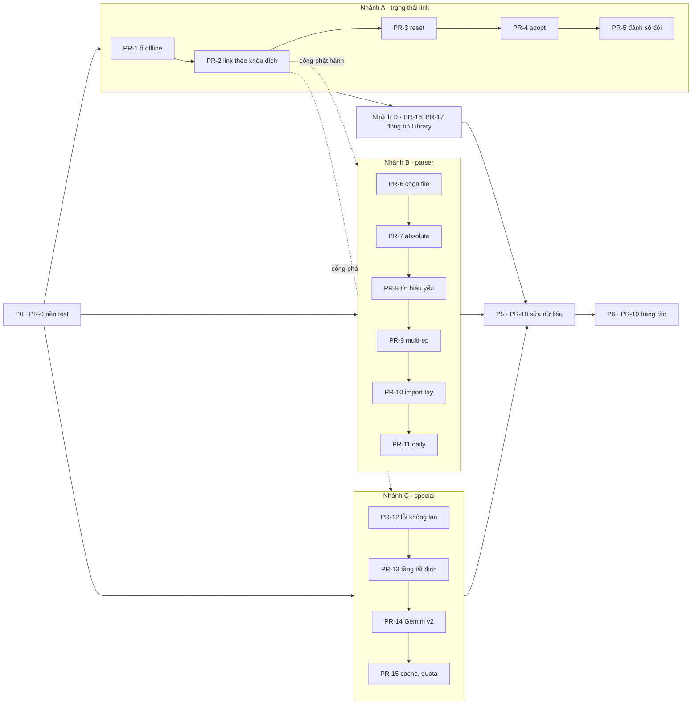

# Kế hoạch sửa triệt để chuỗi parse → special → link (PARSE-01..32)

Ngày: 12/11/2026. Nhánh `claude/parser-audit-5f9a30`. Chưa sửa code app.

Nguồn: [parser-audit.md](parser-audit.md), [phụ lục A](parser-audit-appendix-special.md) và [phụ lục B](parser-audit-appendix-link.md). Đường dẫn code tính từ `media management app/media management app/`, số dòng theo `main` (`ff2caa3`).

## 0. "Xong triệt để" nghĩa là gì

1. Mỗi PARSE-xx có trạng thái cuối: đã sửa kèm test, hoặc user quyết định không sửa và ghi lý do. Bảng truy vết ở mục 8.
2. Mọi kịch bản đã tái hiện trong đợt audit thành test chạy được bằng `dotnet test`: 35 case (mục 2), kịch bản pack A–M (mục 3), harness link A–G (phụ lục B), probe special (phụ lục A).
3. Dữ liệu đã ghi sai được sửa. Sửa code không tự sửa link cũ, nên cần một bước kiểm tra Library chạy thử (dry-run) rồi mới áp (P5).
4. Có hàng rào cho lỗi chưa biết: khi không chắc thì đưa vào review, hoặc bỏ qua và báo rõ. Không đoán rồi link mà không báo.

## 1. Bốn nguyên nhân gốc

32 finding quy về 4 gốc. Sửa ở gốc thì một PR đóng được nhiều finding.

| Gốc | Mô tả | Finding |
|---|---|---|
| G1 | Link được nhận diện theo `FilePath`. App không có khái niệm "đích mong muốn". Link lại chỉ chép provenance, không so S/E | 12, 24, 26, 30, 31, 32 |
| G2 | Heuristic trả về một phỏng đoán khi không chắc (`Infer` trả pattern đã trượt validate, folder hint đè `SxxEyy`, khớp số trần). Ba parser có luật khác nhau | 01, 02, 03, 04, 05, 06, 07, 08, 15, 17, 25 |
| G3 | Special: rule được áp mà không qua review; payload Gemini sai thứ tự; không có kiểm tra cứng sau Gemini; cache không được kiểm lại | 09, 10, 11, 16, 18, 19, 20, 21, 22, 23 |
| G4 | Reconcile coi "không thấy" là "đã mất", và bỏ qua lỗi gỡ link | 27, 28, 29 |

Thứ tự ưu tiên mới cho câu hỏi "file này là tập nào" (áp ở mọi luồng, ghi thành test):

1. `SxxEyy` trong tên file với mùa > 0, hoặc Sonarr ra `EpisodeNumbers`.
2. Số tuyệt đối (Sonarr `AbsoluteEpisodeNumbers`), quy đổi sang (mùa, tập) bằng số tập TMDB.
3. Folder mùa đơn (`Season 02`, `S02`).
4. Owner season của pack.
5. Pattern suy luận, **chỉ** khi pattern qua validate.
6. Không ra kết quả thì bỏ qua và báo lý do. Không có bước "đoán đại".

## 2. Nguyên tắc làm

- Mỗi PR nhỏ, gom các finding cùng gốc. Viết test tái hiện finding trước (test đỏ), rồi mới sửa.
- Không làm đổi kết quả của link đang đúng. Mỗi PR đổi mapping phải chạy lại harness dữ liệu thật ở chế độ read-only: 271 link hiện tại phải ra đúng đích cũ.
- Chạy cả hai bộ test: `dotnet test MediaManager.Core.Tests -c Release` và `dotnet test MediaManager.App.Tests -c Release -p:Platform=x64`.
- Test không gọi Gemini. Response giả lấy từ các kiểu sai đã ghi lại trong đợt audit. Gemini thật chỉ dùng một lần ở PR-14, với trần request như đợt audit.
- Không đưa tên file, tên torrent hay đường dẫn thật của user vào repo. Repo GitHub đang ở chế độ **public** (xem Q5).

## 3. Lộ trình

**Cổng phát hành:** không phát hành PR nào làm đổi mapping (nhánh B, PR-13 đến PR-15) trước PR-2. Nếu không, user bấm Link lại sau khi cập nhật sẽ dính PARSE-24: cờ orphan bị lật trong khi S/E giữ nguyên.

Kích thước: S là dưới 1 ngày công, M là 1–3 ngày, L là trên 3 ngày.

### P0 — Nền test (PR-0, M, không đổi code app)

- `MediaManager.App.Tests` hiện chưa có test nào cho pack, link hay special. Cần đưa harness của đợt audit vào:
  - `Link/LinkTestHost.cs`: SQLite tạm, thư mục download/library tạm, `IQbittorrentClient` giả, `ISymlinkService` giả (ghi file thường), logger và settings giả. Lấy từ `parser-audit-harness/linkharness/Program.cs`.
  - `Pack/PackScenarioTests.cs`: kịch bản A–M qua `PackTorrentInventoryAnalyzer.Analyze` ở chế độ Link.
  - `Special/Fixtures/`: cây pack dạng Show E (S1 và S2 mỗi mùa 7 file `SnSnn`, một OVA không số), danh sách S00 32 tập, các response Gemini giả (gồm kiểu sai 7/15). Tên show và tên file viết lại dạng tổng quát (Q5).
- Core: thêm 35 case của mục 2 vào `TorrentCandidateParserTests`.
- Test mô tả **hành vi đúng**, gắn `Skip = "PARSE-xx"`. Mỗi PR sửa bỏ `Skip` của finding mình đóng. Đếm số test còn `Skip` là biết còn bao nhiêu finding.

### Nhánh A — Trạng thái link (G1, G4)

**PR-1 — PARSE-27: reconcile không xóa khi ổ không truy cập được (S)**
- `TorrentReconciliationService` (dòng 92-93, 154-161) và `AutoTorrentLinkService.RefreshLinkStatus` (292-311): nhóm dòng theo root của `FilePath` và `LinkedPath`. Root, `SavePath` hay `LibraryRoot` không tồn tại thì bỏ qua cả nhóm, log cảnh báo một lần.
- Không purge dòng của torrent mà qBittorrent báo `missingFiles`.
- Test: harness D. Đổi tên `dl`/`lib` thì số dòng giữ nguyên. Trả lại thư mục thì tập vẫn Available, không có lỗi "Output already exists".

**PR-2 — PARSE-24, PARSE-12, PARSE-32: link theo khóa đích (M, là cổng)**
- `LinkSourceItem` (858-876) và `TryGetExistingLinkedItem` (939-951): tính khóa đích `(ProviderId, MediaKind, Season, Episode, IsOrphanPackSpecial)` của lần link mới và so với dòng cũ.
  - Trùng khóa: giữ "already linked" như hiện tại.
  - Khác khóa: gỡ link cũ (`RemoveHardLink` cộng `PublishHardlinkRemoved`), tạo link theo khóa mới, ghi vào kết quả "mapping changed S00E08 → Season Unknown".
  - Đã có một dòng Linked **khác** `FilePath` cho cùng `(ProviderId, S, E)`: bỏ qua và báo (PARSE-32), không tạo link thứ hai khác đuôi.
- Thêm chế độ xem trước: trả danh sách thay đổi mà không ghi. P5 dùng chế độ này.
- Test: harness A, B; LINK-09 (`.mkv` và `.mp4`).
- Đóng luôn ghi chú 1, 5, 6 của phụ lục B (tái dùng `LinkedPath` cũ, "already linked" bỏ qua `MediaKind`, ghi đè `SymlinkPath`).

**PR-3 — PARSE-28: reset dừng khi gỡ link lỗi (S)**
- `ResetEpisodeForRedownload` (322-347) và `ResetMovieForRedownload` (470-494): cộng `ErrorCount` vào kết quả. Có lỗi thì không xóa dòng, không xóa hash, giống `ResetSeasonPackForRedownloadAsync`.
- `LibraryViewModel.cs:762-765` hiện lỗi thay vì luôn báo "reset".
- Test: harness C (file Library đang mở với `FileShare.Read`).

**PR-4 — PARSE-25: adopt torrent thêm tay (M)**
- `MatchesEpisode` (524-534): bỏ nhánh `ContainsNumberToken`. Chỉ nhận khi `SxxEyy` khớp, hoặc `TorrentCandidateParser.Parse(…, allowAnimeAbsolute: true)` ra đúng S/E.
- `ContainsNormalized` (577-581): so theo từ, không so chuỗi con.
- Reconcile theo scope show: `usedHashes` gồm hash của mọi show, mùa và phim đang track.
- `SelectEpisodeFile` (1143-1155): torrent chỉ có 1 file vẫn phải parse ra đúng S/E, không khớp thì không link.
- Test: harness F (`AAC2.0` không còn thành tập 2), torrent phim kiểu Spinoff Movie không thành ứng viên tập. Chạy lại `adopt_sim2.py` trên dữ liệu thật: kỳ vọng 0/122 khớp sai (hiện là 47).

**PR-5 — PARSE-26, PARSE-31: đánh số tập thay đổi (M)**
- Đổi Episode Organization (`TrackedShowService.cs:86-117`): gọi `RemoveShowLinks` và xóa các `SourceItem` TV của show **trước** `DeleteTrackedSeasonsAndEpisodes`, đúng như hộp thoại đã hứa.
- Refresh TMDB (`ImportShow`): sau khi upsert, tìm `TrackedEpisode` không còn trên TMDB. Chưa có link thì xóa. Đã có link thì đánh dấu "removed upstream" và hiện trong UI để user xử lý, không im lặng.
- Test: đánh số giả thay đổi trên SQLite tạm (S01E13 chuyển thành S02E01).

### Nhánh B — Parser và chọn file (G2)

**PR-6 — PARSE-02, PARSE-07, phần đuôi file của PARSE-13: chọn đúng file (M)**
- Một hàm dùng chung trong Core, `IsSampleOrProof(relativePath)`: segment hoặc từ `sample`/`proof`, so theo từ. Áp ở `GetCompletedVideoFilesAsync`, `PackSeasonFileGrouper`, `PackEpisodeResolver` và `SelectEpisodeFile`.
- Giữ `Size` trong danh sách file của pack. `TorrentContentFile` đã có `Size`, nhưng `ResolveSeason` hiện chỉ nhận `(RelativePath, FileName)`.
- `RevisionRegex` và `TorrentCandidateParser.EpisodeRegex` nhận `v\d` ngay sau số tập (`E03v2`, `- 05v2`).
- Khi hai bản hòa nhau: revision, rồi chất lượng (`TorrentQuality.Detect`), rồi dung lượng, cuối cùng mới đến đường dẫn. Log bản bị loại.
- Một danh sách đuôi video dùng chung cho `TorrentContentFile` và `TorrentMetadataProbeResult`, thêm `.ts`, `.m2ts`, `.webm`, `.wmv`.
- Test: kịch bản E, F, J; tên dạng `S01E03v2`.

**PR-7 — PARSE-01, PARSE-17: số tập tuyệt đối (M)**
- `PackEpisodePatternInferrer.Infer` (157-176): trả `Invalid` khi pattern trượt `ValidatePattern` (bỏ `?? pattern`). Ưu tiên pattern "số ở cuối sau `-`".
- `PackEpisodeResolver`: dùng `AbsoluteEpisodeNumbers` khi `EpisodeNumbers` rỗng. `ResolveSeason` nhận thêm số tập theo mùa của cả show (lấy từ `TrackedEpisode`), quy đổi absolute → (mùa, tập). Absolute nằm trong 1..N của mùa đang xét thì giữ nguyên.
- Hai file cùng ra một tập mà không khác revision hay chất lượng: đây là dấu hiệu mapping sai, không phải bản trùng. Bỏ cả nhóm vào Skipped kèm lý do, thay vì chọn theo thứ tự chữ.
- Special `- NN`: sort tự nhiên. Không chạy Ordinal khi `LocalIndex` trùng nhau.
- Test: kịch bản G, H; batch `- 01..12` và `- 13..24` dạng của pack GroupK (kỳ vọng 12/12 đúng số); special `- 01..12` (SPEC-01).

**PR-8 — PARSE-04, PARSE-03, PARSE-08: tín hiệu yếu không đè tín hiệu mạnh (M)**
- Viết thứ tự ưu tiên ở mục 1 thành một chỗ dùng chung cho grouper và analyzer.
- `TryParseSeasonFolderSegment` (261-312): chỉ nhận segment là một mùa đơn. Bỏ qua `1-3`, `1~3`, `Seasons`, `Complete`. Gặp `Part N` thì tách nhóm riêng và đánh dấu cần review.
- Sonarr ra mùa khác với nhóm thì không chạy inferrer cho file đó.
- Từ khóa special/OVA (225-234, 371-372) chỉ gắn special khi file không có số tập thường, hoặc khi từ khóa đứng sát số (`OVA 02`, `Special 1`, `SP01`).
- "movie": một hàm dùng chung cho `PackSeasonFileGrouper`, `PackTorrentInventoryAnalyzer` và `PackSpecialBucketDetector`. So theo từ, chỉ tính khi file không có `SxxEyy` hoặc nằm trong folder `Movies`/`Films`.
- Test: kịch bản A, C, D, K, M; case 17–20; fuzz chèn "Special" (hiện 221/225 bị gắn special).

**PR-9 — PARSE-06: file nhiều tập (M, cần Q1)**
- `EpisodeRegex` nhận `E01E02`, `E01-E02`, `E01-02`. Resolver trả mọi tập trong `EpisodeNumbers`.
- Tên đích `Show - S01E01-E02.ext` (Jellyfin hiểu dạng này).
- `SourceItems` thêm cột `LastEpisodeNumber` (nullable) qua migration. Availability đánh dấu cả dải.
- Test: kịch bản F, L.

**PR-10 — PARSE-05: import tay anime absolute (S)**
- `TmdbMetadataProvider.MapTvEpisodeAsync` (729-775, 870-871): bỏ Season 0 khỏi mapping absolute. Cộng dồn trước. "Khớp số trực tiếp" chỉ dùng khi mùa đó đánh số liên tục (tập đầu của mùa > 1), để giữ case Show L 1154–1162.
- Test bằng `HttpMessageHandler` giả: dạng Show L; show có S00 nhiều tập; S1 = 12, S2 = 12, S3 = 24 tập.
- Làm sau khi `fix/network-package-1` merge, vì nhánh đó sửa cùng file (117 dòng). `feat/native-search` cũng thêm `GetImdbIdAsync` vào file này.

**PR-11 — PARSE-15 và các ghi chú ở mục 6 của báo cáo (S)**
- Daily: tìm tập theo `AirDate`.
- Inspect không đếm file không ra số tập là `RegularEpisode`.
- `CompactSeasonEpisodeSuffixRegex` thêm `\b` ở đầu.
- Kết quả Sonarr có mùa lớn hơn số mùa của show (năm trong tên phim thành `S20E19`) thì bỏ.

### Nhánh C — Special/OVA với Gemini free (G3, theo thiết kế mục 10.3)

**PR-12 — PARSE-10, PARSE-20, PARSE-23: lỗi không lan ra cả lần link (M, không đổi mapping)**
- Tách link tập thường khỏi bước special: tập thường link xong trước, special lỗi chỉ ảnh hưởng special.
- Gemini lỗi, hết quota, parse lỗi, trùng `candidateIndex` hay trùng S00E: rơi về kết quả rule và bắt buộc review. Không ném exception.
- `SpecialMappingCompactJson.TryParseResponse`: `TryGetInt32`, kiểm `ValueKind` của root, bắt mọi exception, bắt buộc có `m` kiểu mảng.
- `ToDictionary` ở `PackSpecialPayloadBuilder.cs:506-509`: gom nhóm, bỏ cặp trùng kèm cảnh báo.
- Progress: `MarkFailed` khi Apply lỗi, thêm nút Cancel, không nuốt `OperationCanceledException`.
- Kèm các ghi chú R5 (đọc `finishReason`), R6 (phân loại lỗi HTTP: 400 do key sai không thử hết model; đọc `retryDelay` trong body), R10 (cảnh báo `CountMismatch`).
- Test: probe A và E (SPEC-04, SPEC-05); Gemini giả ném lỗi thì tập thường vẫn link.

**PR-13 — PARSE-09, PARSE-18, PARSE-19: tầng tất định, rule phải qua review (L)**
- Bộ map mới `SpecialSeasonWindowMapper` (10.3, bước 1):
  - chia S00 thành khối theo khung phát sóng của từng mùa;
  - file `SnSnn` hoặc trong `Season n/Specials` thứ *k* thành phần tử thứ *k* của khối *n*, khi số file vừa với khối;
  - còn đúng một file không số và đúng một chỗ trống thì ghép, đánh dấu "suy luận".
- Flatten và Ordinal cũ chỉ còn là đề xuất. Mọi kết quả không phải Direct đều phải qua màn review, kể cả khi không dùng Gemini. `S00Exx` trong tên file (Direct) là trường hợp duy nhất được tự áp.
- OVA-dash: chỉ đề xuất khi tiêu đề TMDB của tập đó có "OVA" cộng đúng số.
- Title matcher: bỏ stopword, tên show, `ova`/`special`, group tag và số; chấm điểm trên tiêu đề tập; cần ≥60% token có nghĩa của tiêu đề TMDB; hòa điểm thì không chọn. Dùng lại `TitleNormalizer` của `feat/native-search` nếu nhánh đó đã merge.
- Màn review (`PackLinkReviewWindow`, `PackLinkReviewViewModel`): mỗi dòng hiện tên file, `S00Exx`, **tiêu đề và ngày phát sóng TMDB**, nguồn (Direct, Window, Gemini, Rule) và cảnh báo của validator. Liệt kê cả file Skipped (R2). Không có thông tin này thì user không thể bắt được lỗi kiểu PARSE-16.
- Kèm R1 (xóa API `LinkSeasonPackFromInventoryAsync` không có caller) và R8 (không quyết style cho cả bucket chỉ nhờ một nửa số file).
- Test: cây dạng Show E 15/15 không gọi Gemini; recap 2010 (kịch bản I); `OVA - 05` khớp nhờ stopword (SPEC-03); `OVA - 01` (SPEC-02).

**PR-14 — PARSE-16, PARSE-21, SPEC-10: Gemini chỉ cho phần còn lại (M)**
- Payload v2:
  - chỉ gửi file mà tầng 1 chưa giải;
  - file không số xếp sau file có số trong cùng khối;
  - gửi `sw` (khung phát sóng), tiêu đề TMDB, tiêu đề trích từ tên file;
  - không gửi proposals, chỉ gửi các cặp tầng 1 đã chắc dưới dạng "đã cố định";
  - ghi rõ `candidateIndex` là vị trí 0-based;
  - schema giới hạn `s00e` bằng `enum` các số hợp lệ;
  - không escape ký tự non-ASCII (R4).
- Riêng tư: chỉ gửi tên file cộng tên folder cha gần nhất. API key đi qua header `x-goog-api-key`, không nằm trong query string. Sửa câu trong hộp thoại xác nhận cho khớp.
- Kiểm tra cứng sau Gemini (mở rộng `SpecialMappingValidator`):
  - mỗi file và mỗi tập S00 chỉ dùng một lần;
  - tập nằm trong khung mùa cha, cho phép một biên nhỏ;
  - trong một khối, giữ thứ tự `localIndex`;
  - không đè `S00Exx` hoặc `SxxEyy` có sẵn trong tên file;
  - index ngoài khoảng thì cảnh báo.
  
  Cặp vi phạm bị bỏ và đưa vào review.
- Gọi hai lần, chỉ nhận cặp hai lần trùng nhau (Q4). Pack mà tầng 1 giải hết thì tốn 0 request.
- Hằng `SpecialPromptVersion` (dùng cho cache ở PR-15).
- Kiểm Gemini thật một lần, trần khoảng 20 request: Show E (tắt tầng 1 để buộc qua Gemini) 15/15, Show N 0/8, ca recap đúng hoặc vào review.

**PR-15 — PARSE-11, PARSE-22, SPEC-09: cache và quota (M)**
- Key cache: `(hash, tmdbId, hash danh sách S00, hash danh sách candidate, SpecialPromptVersion, model)` (gồm R3).
- Chỉ lưu sau khi user Accept. Không lưu kết quả 0 mapping khi có ứng viên. Cache trúng thì chạy lại kiểm tra cứng của PR-14, trượt thì coi như miss. Thêm lock cho `_entries`. Chỉ lưu `(S, E, Title, AirDate)`, bỏ `Overview`/`Thought`.
- Entry cũ (key v1) không xóa. Khi đọc thì chạy kiểm tra cứng và so với tầng 1; qua thì giữ như một kết quả đã Accept. Nhờ vậy entry Show E ngày 23/06 (đang đúng) được giữ.
- Quota: tính ngày theo giờ Pacific, đếm theo từng model, đếm mọi request đã gửi. Trần mỗi model đặt theo hạn mức free thật trong AI Studio (user xem giúp, xem Q7).
- Refresh catalog model đọc hết các trang (SPEC-09). Model lạ bị thay thì cảnh báo (R7).

### Nhánh D — Đồng bộ Library (sau nhánh A)

**PR-16 — PARSE-29, PARSE-30 (M)**
- `RefreshLinkStatus` thấy link mất thì phát `HardlinkRemoved`, xóa symlink và `SymlinkPath`. Availability đòi `State == Linked`. Tập trong mùa pack được link lại ở lần Link pack kế tiếp.
- Import tay bỏ qua file nằm dưới `LibraryRoot`/`UnifiedRoot` và file đã có `SourceItem`. Gỡ link xử lý cả nhóm dòng cùng `LinkedPath`.
- Ghi chú 4 của phụ lục B (đổi tên show để lại folder cũ) xử lý ở đây nếu kịp.

**PR-17 — PARSE-14: chỗ đặt orphan extras (S, cần Q2)**

### P5 — Sửa dữ liệu đã ghi (PR-18, M)

- Công cụ "Kiểm tra Library": với mỗi `SourceItem`, chạy parser và mapping mới, so với đích hiện tại, liệt kê khác biệt. Không ghi gì.
- User xem danh sách rồi áp. Bước áp dùng đường "mapping changed" của PR-2. Backup `media-manager.db` và `gemini-mapping-cache.json` trước khi áp.
- Đã biết sẵn cần xử lý:
  - 3 cặp `SourceItem` chung `LinkedPath` (Movie One, Movie Two, Movie Three);
  - 16 orphan (14 của TMDB 154494, 2 của 94359), xem lại theo luật mới của PARSE-03 và PARSE-14;
  - `LastPackLinkTorrentHash` NULL ở Show K S1–4 và Show E S2;
  - torrent GroupK vẫn còn trong qBittorrent: user tự quyết giữ hay xóa.
- Kỳ vọng: 271 link đang đúng không đổi đích.

### P6 — Hàng rào lâu dài (PR-19, M)

- Golden test: `TorrentCandidateParser` và Sonarr phải ra cùng S/E trên một bộ tên file đại diện. Chỗ lệch nằm trong danh sách ngoại lệ có ghi lý do.
- Fuzz với seed cố định trong test: chèn `v2`, "Special", multi-ep, dải mùa.
- Test bất biến: đảo thứ tự file đầu vào không làm đổi kết quả.
- Cột `MappingSource` trong `SourceItems` (Sonarr, Absolute, FolderHint, Inferrer, Direct, Window, Gemini, Cache, User). Lần sau gặp link sai thì biết ngay bước nào quyết định.
- Giữ log quyết định special (không có key) lâu hơn vòng dọn log. Đợt audit này không giải thích được cache tháng 6 chính vì log đã mất.

## 4. Chạy song song và chỗ dễ đụng nhau

Đề xuất 3 phiên, mỗi phiên một worktree riêng:

| Phiên | Phạm vi | File chính |
|---|---|---|
| A | phần link host của PR-0, nhánh A, nhánh D | `AutoTorrentLinkService.cs` (link, reset, refresh), `TorrentReconciliationService.cs`, `TrackedShowService.cs`, `HardlinkService.cs`, `MediaImportService.cs` |
| B | phần Core của PR-0, nhánh B | `TorrentCandidateParser.cs`, `PackEpisodePatternInferrer.cs`, `PackSeasonFileGrouper.cs`, `PackEpisodeResolver.cs`, `PackTorrentInventoryAnalyzer.cs` (classify), `TmdbMetadataProvider.cs` |
| C | nhánh C | `PackSpecialPayloadBuilder.cs`, `SpecialMappingOrchestrator.cs`, `Services/Gemini/*`, `SpecialMappingCache.cs`, `SpecialEpisodeTitleMatcher.cs`, `PackLinkReview*` |

File cả hai phía cùng sửa:
- `AutoTorrentLinkService.cs`: A sửa phần link/reset/refresh, B sửa `SelectEpisodeFile` và danh sách file. Merge A trước.
- `PackTorrentInventoryAnalyzer.cs` và phần pack prepare/apply: B sửa classify, C (PR-12) tách tập thường khỏi special. Merge B trước, hoặc C rebase sau PR-8.
- Migration DB: PR-9 (`LastEpisodeNumber`) và PR-19 (`MappingSource`). Đi chung một chuỗi số migration.

## 5. Phối hợp với các phiên audit khác

Các phiên dưới đây đang chạy và chưa có báo cáo trong thư mục ghi chú chung. Cột "chỗ chồng" suy từ tên phiên. Trước khi bắt đầu PR liên quan cần đọc báo cáo của họ để không sửa một lỗi hai lần.

| Phiên | Chỗ có thể chồng | Việc cần làm |
|---|---|---|
| deletion-audit | PARSE-28, PARSE-30 (gỡ link, reset) | đọc trước PR-3, PR-16 |
| database-audit | migration mới; `FilePath UNIQUE` phân biệt hoa thường (ghi chú 3 phụ lục B); PARSE-27 | thống nhất chuỗi migration |
| autotrack-audit | PARSE-25, 27, 29 (reconcile theo lịch, adopt) | đọc trước PR-1, PR-4 |
| lifecycle-audit | PARSE-26, 31 (refresh TMDB, đổi organization), nếu nằm trong phạm vi | đọc trước PR-5 |
| settings-audit | PARSE-22, SPEC-10 (key Gemini, quota) | đọc trước PR-14, PR-15 |
| hunt-search-audit, `feat/native-search` | mục 8 của báo cáo (parser trong search); `TitleNormalizer`; `TmdbMetadataProvider` | PR-7, 8, 9 chạy cả test của search; PR-13 dùng lại `TitleNormalizer` |
| `fix/network-package-1` | `TmdbMetadataProvider.cs` | PR-10 làm sau khi nhánh này merge |

## 6. Quyết định cần user

| # | Câu hỏi | Đề xuất |
|---|---|---|
| Q1 | File nhiều tập (PARSE-06) | Đặt tên `S01E01-E02` và thêm cột `LastEpisodeNumber` để đánh dấu cả hai tập. Cách nhẹ hơn: chỉ link một lần, đánh dấu cả hai tập là có, không đổi tên |
| Q2 | Chỗ đặt orphan extras (PARSE-14) | `Season NN/extras/<tên gốc>` khi biết mùa, ngược lại `<Show>/extras/`. Jellyfin nhận folder `extras`, còn `Season Unknown` thì không |
| Q3 | Link phụ đề và audio rời (phần còn lại của PARSE-13) | Để sau. Đây là tính năng mới, không phải sửa lỗi |
| Q4 | Gọi Gemini hai lần để tự kiểm (PR-14) | Bật. Tốn 2 request mỗi pack, và chỉ cho pack mà tầng tất định không giải hết |
| Q5 | Dữ liệu thật trong repo | Repo GitHub đang **public**. Fixture chỉ dùng tên tổng quát. Báo cáo audit hiện có tên show, tên torrent và số dòng DB thật, nên cần xem lại trước khi push nhánh này |
| Q6 | Cách chạy | 3 phiên song song theo mục 4, mỗi phiên một worktree, PR riêng từng bước |
| Q7 | Hạn mức free của model Gemini | User xem trong AI Studio hạn mức ngày của `gemini-2.5-flash-lite` và `gemini-2.0-flash` để đặt trần ở PR-15 |

## 7. Tiêu chí xong toàn bộ

- 32/32 PARSE có trạng thái cuối (bảng mục 8).
- Không còn test nào mang `Skip = "PARSE-*"`.
- Dữ liệu thật, chạy harness read-only:
  - pack dạng GroupK: 12/12 tập đúng số (hiện 9/12);
  - special Show E: 15/15 mà không gọi Gemini;
  - 271 link hiện tại không đổi đích;
  - mô phỏng adopt: 0/122 torrent khớp sai tập (hiện 47).
- Gemini thật: Show E 15/15 cả 2 lần, Show N 0/8, ca recap không bao giờ sai mà không báo.
- Hai bộ test pass ở Release x64.

## 8. Bảng truy vết

| PARSE | Mức | PR | Ghi chú |
|---|---|---|---|
| 01 | High | PR-7 | |
| 02 | High | PR-6 | |
| 03 | High | PR-8 | |
| 04 | High | PR-8 | |
| 05 | High | PR-10 | sau `fix/network-package-1` |
| 06 | Medium | PR-9 | Q1 |
| 07 | Medium | PR-6 | |
| 08 | Medium | PR-8 | |
| 09 | Medium | PR-13 | |
| 10 | Medium | PR-12 | |
| 11 | Medium | PR-15 | |
| 12 | Medium | PR-2 | |
| 13 | Low | PR-6 | phần đuôi file; sidecar theo Q3 |
| 14 | Low | PR-17 | Q2 |
| 15 | Low | PR-11 | |
| 16 | High | PR-14 | |
| 17 | Medium | PR-7 | |
| 18 | Medium | PR-13 | |
| 19 | Medium | PR-13 | |
| 20 | Low | PR-12 | |
| 21 | Low | PR-14 | |
| 22 | Low | PR-15 | Q7 |
| 23 | Low | PR-12 | |
| 24 | High | PR-2 | cổng phát hành |
| 25 | High | PR-4 | |
| 26 | High | PR-5 | |
| 27 | High | PR-1 | |
| 28 | Medium | PR-3 | |
| 29 | Medium | PR-16 | |
| 30 | Medium | PR-16, PR-18 | 3 cặp thật sửa ở P5 |
| 31 | Medium | PR-5 | |
| 32 | Low | PR-2 | |

Ghi chú chưa đủ chuẩn finding:
- SPEC-09 vào PR-15. SPEC-10 vào PR-14 (payload, key) và PR-15 (nội dung cache).
- Phụ lục A: R1, R2, R8 vào PR-13; R3, R7 vào PR-15; R4 vào PR-14; R5, R6, R10 vào PR-12. R9 (key `m` trùng thì key cuối thắng) chỉ ghi lại, không sửa.
- Phụ lục B: ghi chú 1, 5, 6 vào PR-2; ghi chú 4 vào PR-16; ghi chú 3 chuyển database-audit. Ghi chú 2 (thứ tự event symlink) và 7 (bulk scope toàn cục) chưa tái hiện được: thêm test ở PR-16, chỉ sửa nếu test đỏ.
- Mục 6 của báo cáo vào PR-11. Riêng `NormalizedTitle` của show tên là năm (`1923`) và các số `480/720/1080/2160` thuộc phía search (`feat/native-search`).
